# JARKOM MODUL 4 2026 - K-45

## Anggota

| Nama                         | NRP        |
| ---------------------------- | ---------- |
| Abhista Athallah Dyfan       | 5027251006 |
| Rifqi Dwi Muslim             | 5027251077 |

---

Soal mewajibkan topologi The Wired Expansion dikerjakan pada Cisco Packet Tracer dan GNS3 dengan metode perhitungan classless yang berbeda. Kami memakai VLSM pada GNS3 yang dikerjakan oleh Rifqi Dwi Muslim(077) dan CIDR pada Cisco Packet Tracer yang dikerjakan oleh Abhista Athallah Dyfan(006). 

**Daftar node:**

| Jumlah | Jenis node       | Node |
| ------ | ---------------- | ---- |
| 13     | Docker (debinet) | Cyberia, Wired, Psyche, Copland, Schumann, Accela, Navi, Tachibana, Deus, Protocol7, Knights, Phantoma, Shibuya |
| 25     | Docker (debinet) | JJ, MyuMyu, Karl, Lin, Juri, Masayuki, Akashic, Omnipresence, Denpa, Alice, Reika, Taro, Yasuo, Miho, Kuma, Collective, Ghost, Lilith, Specter, Chisa, Hodgeson, Eiri, Semi, Lain, Mika |
| 13     | Ethernet switch  | Switch1 sampai Switch13 |
| 1      | NAT              | NAT1 |

Seluruh router dan end device memakai image `debinet`. Setiap end device mewakili seluruh host pada node tersebut, sehingga cukup diberi satu alamat IP.

**TOPOLOGI JARINGAN:**


<br>

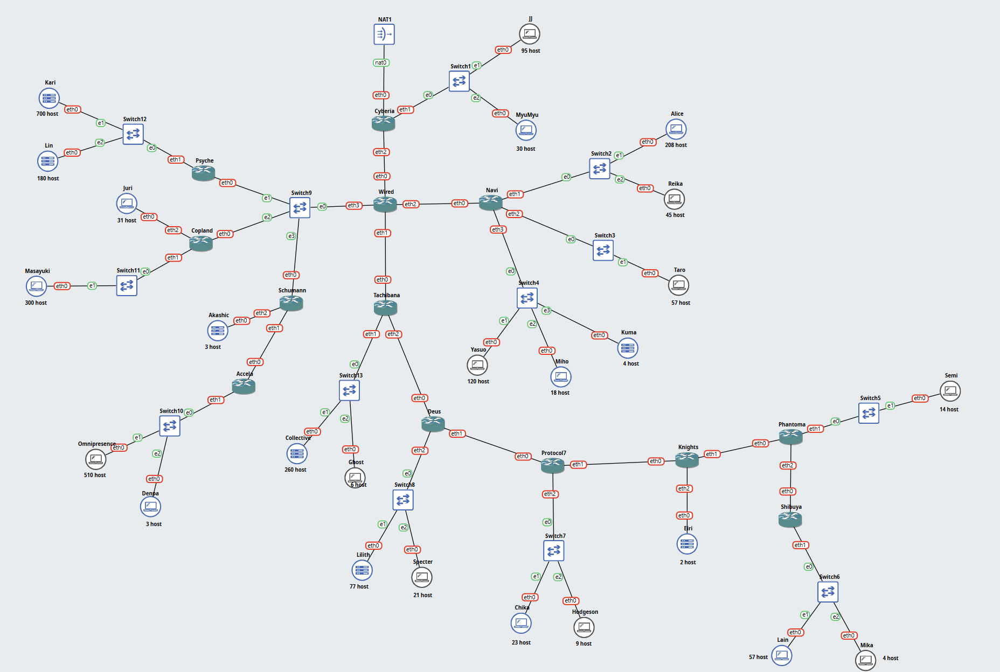

*Gambar 1. Topologi The Wired Expansion pada GNS3*


<br>

---

## Rancangan Pengalamatan IP

Prefix kelompok adalah **`10.86.x.x`**. Hasil perhitungan VLSM menghasilkan root **`10.86.0.0/19`** (`255.255.224.0`) yang dibagi menjadi 25 subnet. Alamat terakhir yang terpakai adalah `10.86.16.91`.

| Subnet | Rute | Jumlah IP | Network ID | Netmask | Broadcast | Range IP |
| ------ | ---- | --------- | ---------- | ------- | --------- | -------- |
| A1 | Cyberia > JJ, MyuMyu | 126 | 10.86.14.0/25 | 255.255.255.128 | 10.86.14.127 | 10.86.14.1 - 10.86.14.126 |
| A2 | Cyberia > Wired | 2 | 10.86.16.56/30 | 255.255.255.252 | 10.86.16.59 | 10.86.16.57 - 10.86.16.58 |
| A3 | Wired > Switch2 > Psyche, Copland, Schumann | 4 | 10.86.16.32/29 | 255.255.255.248 | 10.86.16.39 | 10.86.16.33 - 10.86.16.38 |
| A4 | Psyche > Switch3 > Karl, Lin | 881 | 10.86.0.0/22 | 255.255.252.0 | 10.86.3.255 | 10.86.0.1 - 10.86.3.254 |
| A5 | Copland > Juri | 32 | 10.86.15.0/26 | 255.255.255.192 | 10.86.15.63 | 10.86.15.1 - 10.86.15.62 |
| A6 | Copland > Switch4 > Masayuki | 301 | 10.86.8.0/23 | 255.255.254.0 | 10.86.9.255 | 10.86.8.1 - 10.86.9.254 |
| A7 | Schumann > Akashic | 4 | 10.86.16.40/29 | 255.255.255.248 | 10.86.16.47 | 10.86.16.41 - 10.86.16.46 |
| A8 | Schumann > Accela | 2 | 10.86.16.60/30 | 255.255.255.252 | 10.86.16.63 | 10.86.16.61 - 10.86.16.62 |
| A9 | Accela > Switch5 > Omnipresence, Denpa | 514 | 10.86.4.0/22 | 255.255.252.0 | 10.86.7.255 | 10.86.4.1 - 10.86.7.254 |
| A10 | Wired > Navi | 2 | 10.86.16.64/30 | 255.255.255.252 | 10.86.16.67 | 10.86.16.65 - 10.86.16.66 |
| A11 | Navi > Switch6 > Alice, Reika | 254 | 10.86.12.0/24 | 255.255.255.0 | 10.86.12.255 | 10.86.12.1 - 10.86.12.254 |
| A12 | Navi > Switch7 > Taro | 58 | 10.86.15.64/26 | 255.255.255.192 | 10.86.15.127 | 10.86.15.65 - 10.86.15.126 |
| A13 | Navi > Switch8 > Yasuo, Miho, Kuma | 143 | 10.86.13.0/24 | 255.255.255.0 | 10.86.13.255 | 10.86.13.1 - 10.86.13.254 |
| A14 | Wired > Tachibana | 2 | 10.86.16.68/30 | 255.255.255.252 | 10.86.16.71 | 10.86.16.69 - 10.86.16.70 |
| A15 | Tachibana > Switch9 > Collective, Ghost | 267 | 10.86.10.0/23 | 255.255.254.0 | 10.86.11.255 | 10.86.10.1 - 10.86.11.254 |
| A16 | Tachibana > Deus | 2 | 10.86.16.72/30 | 255.255.255.252 | 10.86.16.75 | 10.86.16.73 - 10.86.16.74 |
| A17 | Deus > Switch10 > Lilith, Specter | 99 | 10.86.14.128/25 | 255.255.255.128 | 10.86.14.255 | 10.86.14.129 - 10.86.14.254 |
| A18 | Deus > Protocol7 | 2 | 10.86.16.76/30 | 255.255.255.252 | 10.86.16.79 | 10.86.16.77 - 10.86.16.78 |
| A19 | Protocol7 > Switch11 > Chisa, Hodgeson | 33 | 10.86.15.128/26 | 255.255.255.192 | 10.86.15.191 | 10.86.15.129 - 10.86.15.190 |
| A20 | Protocol7 > Knights | 2 | 10.86.16.80/30 | 255.255.255.252 | 10.86.16.83 | 10.86.16.81 - 10.86.16.82 |
| A21 | Knights > Eiri | 3 | 10.86.16.48/29 | 255.255.255.248 | 10.86.16.55 | 10.86.16.49 - 10.86.16.54 |
| A22 | Knights > Phantoma | 2 | 10.86.16.84/30 | 255.255.255.252 | 10.86.16.87 | 10.86.16.85 - 10.86.16.86 |
| A23 | Phantoma > Switch12 > Semi | 15 | 10.86.16.0/27 | 255.255.255.224 | 10.86.16.31 | 10.86.16.1 - 10.86.16.30 |
| A24 | Phantoma > Shibuya | 2 | 10.86.16.88/30 | 255.255.255.252 | 10.86.16.91 | 10.86.16.89 - 10.86.16.90 |
| A25 | Shibuya > Switch13 > Lain, Mika | 62 | 10.86.15.192/26 | 255.255.255.192 | 10.86.15.255 | 10.86.15.193 - 10.86.15.254 |

Interface eth0 Cyberia memperoleh alamat `192.168.122.x` dari DHCP NAT1 dan berada di luar prefix kelompok, sehingga link Cyberia ke NAT1 tidak dihitung sebagai subnet.

---

## Urutan Pengerjaan

1. Subnet diidentifikasi dari topologi, lalu Jumlah IP setiap subnet dihitung dari jumlah host ditambah interface router.
2. Netmask setiap subnet dan netmask root ditentukan.
3. Pohon VLSM disusun dan Network ID setiap subnet ditetapkan.
4. Alamat IP dibagikan ke setiap interface router dan end device.
5. Topologi dibangun di GNS3, termasuk pengaturan jumlah adapter router.
6. Jaringan setiap node dikonfigurasi melalui **Edit network configuration**, termasuk static routing.
7. Konektivitas diuji dengan `ping` dari end device pada jalur terjauh.

---

### BAGIAN 1, IDENTIFIKASI SUBNET DAN KEBUTUHAN IP

Menghitung Jumlah IP setiap subnet dari jumlah host ditambah jumlah interface router yang berada pada subnet tersebut (ketentuan soal nomor 8), lalu menentukan netmask setiap subnet.

Satu subnet adalah satu broadcast domain. Link router ke router membentuk satu subnet, sedangkan router ke switch beserta seluruh node pada switch tersebut juga membentuk satu subnet. Penamaan subnet dimulai dari Cyberia, lalu menelusuri cabang Wired, segmen Switch2 (Psyche, Copland, Schumann), cabang Navi, dan cabang Tachibana sampai Shibuya.

Netmask dipilih dari blok terkecil yang masih menyisakan alamat untuk Network ID dan Broadcast:

```
2^(32 - prefix) - 2 >= Jumlah IP
```

| Subnet | Rincian Jumlah IP | Jumlah IP | Netmask | Ukuran Blok | IP Usable |
| ------ | ----------------- | --------- | ------- | ----------- | --------- |
| A1 | 95 (JJ) + 30 (MyuMyu) + 1 (Cyberia) | 126 | /25 | 128 | 126 |
| A2 | 1 (Cyberia) + 1 (Wired) | 2 | /30 | 4 | 2 |
| A3 | 1 (Wired) + 1 (Psyche) + 1 (Copland) + 1 (Schumann) | 4 | /29 | 8 | 6 |
| A4 | 700 (Karl) + 180 (Lin) + 1 (Psyche) | 881 | /22 | 1024 | 1022 |
| A5 | 31 (Juri) + 1 (Copland) | 32 | /26 | 64 | 62 |
| A6 | 300 (Masayuki) + 1 (Copland) | 301 | /23 | 512 | 510 |
| A7 | 3 (Akashic) + 1 (Schumann) | 4 | /29 | 8 | 6 |
| A8 | 1 (Schumann) + 1 (Accela) | 2 | /30 | 4 | 2 |
| A9 | 510 (Omnipresence) + 3 (Denpa) + 1 (Accela) | 514 | /22 | 1024 | 1022 |
| A10 | 1 (Wired) + 1 (Navi) | 2 | /30 | 4 | 2 |
| A11 | 208 (Alice) + 45 (Reika) + 1 (Navi) | 254 | /24 | 256 | 254 |
| A12 | 57 (Taro) + 1 (Navi) | 58 | /26 | 64 | 62 |
| A13 | 120 (Yasuo) + 18 (Miho) + 4 (Kuma) + 1 (Navi) | 143 | /24 | 256 | 254 |
| A14 | 1 (Wired) + 1 (Tachibana) | 2 | /30 | 4 | 2 |
| A15 | 260 (Collective) + 6 (Ghost) + 1 (Tachibana) | 267 | /23 | 512 | 510 |
| A16 | 1 (Tachibana) + 1 (Deus) | 2 | /30 | 4 | 2 |
| A17 | 77 (Lilith) + 21 (Specter) + 1 (Deus) | 99 | /25 | 128 | 126 |
| A18 | 1 (Deus) + 1 (Protocol7) | 2 | /30 | 4 | 2 |
| A19 | 23 (Chisa) + 9 (Hodgeson) + 1 (Protocol7) | 33 | /26 | 64 | 62 |
| A20 | 1 (Protocol7) + 1 (Knights) | 2 | /30 | 4 | 2 |
| A21 | 2 (Eiri) + 1 (Knights) | 3 | /29 | 8 | 6 |
| A22 | 1 (Knights) + 1 (Phantoma) | 2 | /30 | 4 | 2 |
| A23 | 14 (Semi) + 1 (Phantoma) | 15 | /27 | 32 | 30 |
| A24 | 1 (Phantoma) + 1 (Shibuya) | 2 | /30 | 4 | 2 |
| A25 | 57 (Lain) + 4 (Mika) + 1 (Shibuya) | 62 | /26 | 64 | 62 |
| **Total** | | **2814** | | **4188** | |

**Hasil:**

- Terdapat 25 subnet, terdiri atas 16 subnet LAN dan 9 link antar-router.
- A3 adalah segmen bersama pada Switch2 yang berisi empat interface router (Wired, Psyche, Copland, Schumann). Kapasitas /30 hanya 2 IP usable, sehingga dipakai **/29**.
- A5 membutuhkan 32 alamat. Blok /27 berisi 32 alamat tetapi hanya 30 yang usable, sehingga dipakai **/26**.
- A7 dan A21 membutuhkan 4 dan 3 alamat, melebihi kapasitas /30, sehingga dipakai **/29**.
- A9 membutuhkan 514 alamat, melebihi 510 IP usable pada /23, sehingga dipakai **/22**.
- A11 (254) dan A25 (62) tepat memenuhi seluruh IP usable pada /24 dan /26.
- Seluruh link antar-router (A2, A8, A10, A14, A16, A18, A20, A22, A24) memakai **/30**.

Tabel ini diisikan ke sheet `Rute` pada template spreadsheet modul 4.

---

### BAGIAN 2, NETMASK ROOT

Menentukan netmask root yang menampung seluruh subnet dengan pembagian seefisien mungkin.

Modul menyebutkan bahwa netmask root tidak hanya ditentukan dari jumlah IP, tetapi juga dari susunan netmask subnet. Setiap subnet menempati satu blok utuh, sehingga yang dijumlahkan adalah ukuran blok.

| Netmask | Ukuran Blok | Banyak Subnet | Total Alamat |
| ------- | ----------- | ------------- | ------------ |
| /22 | 1024 | 2 | 2048 |
| /23 | 512 | 2 | 1024 |
| /24 | 256 | 2 | 512 |
| /25 | 128 | 2 | 256 |
| /26 | 64 | 4 | 256 |
| /27 | 32 | 1 | 32 |
| /29 | 8 | 3 | 24 |
| /30 | 4 | 9 | 36 |
| **Total** | | **25** | **4188** |

**Hasil:**

- Total Jumlah IP adalah **2814**, yang secara angka muat pada /20 (4096 alamat).
- Total ukuran blok adalah **4188**, melebihi 4096, sehingga /20 tidak cukup.
- Netmask root yang dipakai adalah **`/19`** (8192 alamat), yaitu `10.86.0.0/19` dengan rentang `10.86.0.0` sampai `10.86.31.255`.

---

### BAGIAN 3, POHON VLSM

Soal meminta untuk menyusun pohon VLSM untuk menentukan Network ID setiap subnet tanpa ada alamat yang terbuang.

Root dibagi menjadi 2 blok sama besar dengan prefix satu tingkat lebih panjang, lalu pembelahan diulang sampai ukuran blok sesuai kebutuhan subnet. Subnet ditempatkan mulai dari blok terbesar, berurutan dari alamat terendah. Blok berukuran N hanya dapat dimulai pada alamat kelipatan N. Penempatan blok besar terlebih dahulu membuat setiap blok berikutnya otomatis jatuh pada batas yang valid, sehingga tidak ada celah alamat di antara subnet.

Urutan penempatan subnet:

| Urutan | Subnet | Netmask | Network ID |
| ------ | ------ | ------- | ---------- |
| 1 | A4 | /22 | 10.86.0.0 |
| 2 | A9 | /22 | 10.86.4.0 |
| 3 | A6 | /23 | 10.86.8.0 |
| 4 | A15 | /23 | 10.86.10.0 |
| 5 | A11 | /24 | 10.86.12.0 |
| 6 | A13 | /24 | 10.86.13.0 |
| 7 | A1 | /25 | 10.86.14.0 |
| 8 | A17 | /25 | 10.86.14.128 |
| 9 | A5 | /26 | 10.86.15.0 |
| 10 | A12 | /26 | 10.86.15.64 |
| 11 | A19 | /26 | 10.86.15.128 |
| 12 | A25 | /26 | 10.86.15.192 |
| 13 | A23 | /27 | 10.86.16.0 |
| 14 | A3 | /29 | 10.86.16.32 |
| 15 | A7 | /29 | 10.86.16.40 |
| 16 | A21 | /29 | 10.86.16.48 |
| 17 | A2 | /30 | 10.86.16.56 |
| 18 | A8 | /30 | 10.86.16.60 |
| 19 | A10 | /30 | 10.86.16.64 |
| 20 | A14 | /30 | 10.86.16.68 |
| 21 | A16 | /30 | 10.86.16.72 |
| 22 | A18 | /30 | 10.86.16.76 |
| 23 | A20 | /30 | 10.86.16.80 |
| 24 | A22 | /30 | 10.86.16.84 |
| 25 | A24 | /30 | 10.86.16.88 |

<br>

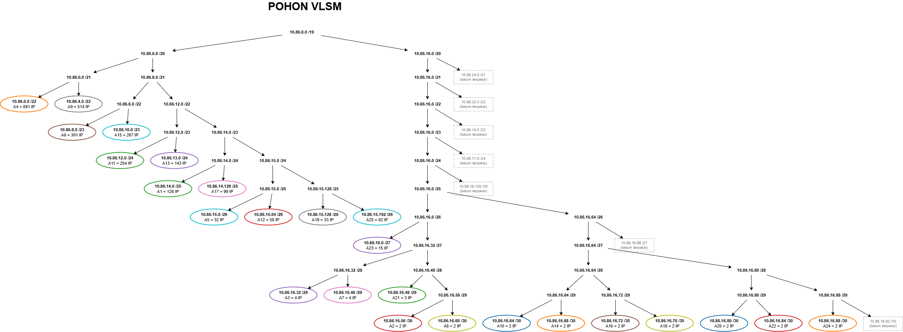

*Gambar 3. Pohon VLSM K-45 dengan root 10.86.0.0/19*

<br>

Diagram Pohon VLSM saya buat memakai drawio, File pohon VLSM dalam dapat dibuka dan disunting melalui tautan berikut: [Pohon VLSM K-45 (draw.io)](https://drive.google.com/file/d/1Vq0qq4vvwFTmASu0k2ccdS35iAa3XBFJ/view?usp=sharing).

Cara membaca pohon:

1. Root `10.86.0.0/19` dibagi menjadi `10.86.0.0/20` dan `10.86.16.0/20`.
2. Cabang `10.86.0.0/20` terisi penuh oleh dua /22 (A4, A9), dua /23 (A6, A15), dua /24 (A11, A13), dua /25 (A1, A17), dan empat /26 (A5, A12, A19, A25). Total kedua belas blok tersebut tepat 4096 alamat.
3. Cabang `10.86.16.0/20` dibelah terus sampai /27 untuk A23, lalu sisanya dipakai oleh tiga /29 (A3, A7, A21) dan sembilan /30.
4. Elips berwarna adalah subnet yang terpakai, sedangkan kotak bergaris putus-putus adalah blok yang belum terpakai.

**Hasil:**

- Seluruh 25 subnet mendapat Network ID tanpa tumpang tindih dan tanpa celah di antara subnet.
- A1 berada di `10.86.14.0` karena di depannya terdapat dua /22, dua /23, dan dua /24 dengan total 3584 alamat (14 × 256).
- Hasil pembagian diisikan ke sheet `Pembagian IP - VLSM` pada template spreadsheet.

---

### BAGIAN 4, PENGALAMATAN INTERFACE ROUTER DAN END DEVICE

Soal meminta membagikan alamat dari setiap subnet ke interface router dan end device.

Aturan pengalamatan mengikuti contoh pada modul:

- Pada link antar-router, router yang lebih dekat ke Cyberia mendapat IP usable pertama, router di bawahnya mendapat IP usable kedua.
- Pada segmen bersama A3, urutannya Wired, Psyche, Copland, lalu Schumann.
- Pada subnet LAN, interface router mendapat IP usable pertama sebagai gateway, lalu end device menerima IP berikutnya.
- Pada setiap router, `eth0` mengarah ke router di atasnya. Cyberia memakai `eth0` untuk NAT1.

**Interface router:**

| Router | Interface | Terhubung ke | Subnet | IP Address | Netmask |
| ------ | --------- | ------------ | ------ | ---------- | ------- |
| Cyberia | eth0 | NAT1 | - | DHCP dari NAT1 | - |
| Cyberia | eth1 | Switch1 (JJ, MyuMyu) | A1 | 10.86.14.1 | 255.255.255.128 |
| Cyberia | eth2 | Wired | A2 | 10.86.16.57 | 255.255.255.252 |
| Wired | eth0 | Cyberia | A2 | 10.86.16.58 | 255.255.255.252 |
| Wired | eth1 | Tachibana | A14 | 10.86.16.69 | 255.255.255.252 |
| Wired | eth2 | Navi | A10 | 10.86.16.65 | 255.255.255.252 |
| Wired | eth3 | Switch2 (Psyche, Copland, Schumann) | A3 | 10.86.16.33 | 255.255.255.248 |
| Psyche | eth0 | Switch2 (Wired, Copland, Schumann) | A3 | 10.86.16.34 | 255.255.255.248 |
| Psyche | eth1 | Switch3 (Karl, Lin) | A4 | 10.86.0.1 | 255.255.252.0 |
| Copland | eth0 | Switch2 (Wired, Psyche, Schumann) | A3 | 10.86.16.35 | 255.255.255.248 |
| Copland | eth1 | Switch4 (Masayuki) | A6 | 10.86.8.1 | 255.255.254.0 |
| Copland | eth2 | Juri | A5 | 10.86.15.1 | 255.255.255.192 |
| Schumann | eth0 | Switch2 (Wired, Psyche, Copland) | A3 | 10.86.16.36 | 255.255.255.248 |
| Schumann | eth1 | Accela | A8 | 10.86.16.61 | 255.255.255.252 |
| Schumann | eth2 | Akashic | A7 | 10.86.16.41 | 255.255.255.248 |
| Accela | eth0 | Schumann | A8 | 10.86.16.62 | 255.255.255.252 |
| Accela | eth1 | Switch5 (Omnipresence, Denpa) | A9 | 10.86.4.1 | 255.255.252.0 |
| Navi | eth0 | Wired | A10 | 10.86.16.66 | 255.255.255.252 |
| Navi | eth1 | Switch6 (Alice, Reika) | A11 | 10.86.12.1 | 255.255.255.0 |
| Navi | eth2 | Switch7 (Taro) | A12 | 10.86.15.65 | 255.255.255.192 |
| Navi | eth3 | Switch8 (Yasuo, Miho, Kuma) | A13 | 10.86.13.1 | 255.255.255.0 |
| Tachibana | eth0 | Wired | A14 | 10.86.16.70 | 255.255.255.252 |
| Tachibana | eth1 | Switch9 (Collective, Ghost) | A15 | 10.86.10.1 | 255.255.254.0 |
| Tachibana | eth2 | Deus | A16 | 10.86.16.73 | 255.255.255.252 |
| Deus | eth0 | Tachibana | A16 | 10.86.16.74 | 255.255.255.252 |
| Deus | eth1 | Protocol7 | A18 | 10.86.16.77 | 255.255.255.252 |
| Deus | eth2 | Switch10 (Lilith, Specter) | A17 | 10.86.14.129 | 255.255.255.128 |
| Protocol7 | eth0 | Deus | A18 | 10.86.16.78 | 255.255.255.252 |
| Protocol7 | eth1 | Knights | A20 | 10.86.16.81 | 255.255.255.252 |
| Protocol7 | eth2 | Switch11 (Chisa, Hodgeson) | A19 | 10.86.15.129 | 255.255.255.192 |
| Knights | eth0 | Protocol7 | A20 | 10.86.16.82 | 255.255.255.252 |
| Knights | eth1 | Phantoma | A22 | 10.86.16.85 | 255.255.255.252 |
| Knights | eth2 | Eiri | A21 | 10.86.16.49 | 255.255.255.248 |
| Phantoma | eth0 | Knights | A22 | 10.86.16.86 | 255.255.255.252 |
| Phantoma | eth1 | Switch12 (Semi) | A23 | 10.86.16.1 | 255.255.255.224 |
| Phantoma | eth2 | Shibuya | A24 | 10.86.16.89 | 255.255.255.252 |
| Shibuya | eth0 | Phantoma | A24 | 10.86.16.90 | 255.255.255.252 |
| Shibuya | eth1 | Switch13 (Lain, Mika) | A25 | 10.86.15.193 | 255.255.255.192 |

**End device:**

| End Device | Jumlah Host | Subnet | IP Address | Netmask | Gateway |
| ---------- | ----------- | ------ | ---------- | ------- | ------- |
| JJ | 95 | A1 | 10.86.14.2 | 255.255.255.128 | 10.86.14.1 |
| MyuMyu | 30 | A1 | 10.86.14.3 | 255.255.255.128 | 10.86.14.1 |
| Karl | 700 | A4 | 10.86.0.2 | 255.255.252.0 | 10.86.0.1 |
| Lin | 180 | A4 | 10.86.0.3 | 255.255.252.0 | 10.86.0.1 |
| Juri | 31 | A5 | 10.86.15.2 | 255.255.255.192 | 10.86.15.1 |
| Masayuki | 300 | A6 | 10.86.8.2 | 255.255.254.0 | 10.86.8.1 |
| Akashic | 3 | A7 | 10.86.16.42 | 255.255.255.248 | 10.86.16.41 |
| Omnipresence | 510 | A9 | 10.86.4.2 | 255.255.252.0 | 10.86.4.1 |
| Denpa | 3 | A9 | 10.86.4.3 | 255.255.252.0 | 10.86.4.1 |
| Alice | 208 | A11 | 10.86.12.2 | 255.255.255.0 | 10.86.12.1 |
| Reika | 45 | A11 | 10.86.12.3 | 255.255.255.0 | 10.86.12.1 |
| Taro | 57 | A12 | 10.86.15.66 | 255.255.255.192 | 10.86.15.65 |
| Yasuo | 120 | A13 | 10.86.13.2 | 255.255.255.0 | 10.86.13.1 |
| Miho | 18 | A13 | 10.86.13.3 | 255.255.255.0 | 10.86.13.1 |
| Kuma | 4 | A13 | 10.86.13.4 | 255.255.255.0 | 10.86.13.1 |
| Collective | 260 | A15 | 10.86.10.2 | 255.255.254.0 | 10.86.10.1 |
| Ghost | 6 | A15 | 10.86.10.3 | 255.255.254.0 | 10.86.10.1 |
| Lilith | 77 | A17 | 10.86.14.130 | 255.255.255.128 | 10.86.14.129 |
| Specter | 21 | A17 | 10.86.14.131 | 255.255.255.128 | 10.86.14.129 |
| Chisa | 23 | A19 | 10.86.15.130 | 255.255.255.192 | 10.86.15.129 |
| Hodgeson | 9 | A19 | 10.86.15.131 | 255.255.255.192 | 10.86.15.129 |
| Eiri | 2 | A21 | 10.86.16.50 | 255.255.255.248 | 10.86.16.49 |
| Semi | 14 | A23 | 10.86.16.2 | 255.255.255.224 | 10.86.16.1 |
| Lain | 57 | A25 | 10.86.15.194 | 255.255.255.192 | 10.86.15.193 |
| Mika | 4 | A25 | 10.86.15.195 | 255.255.255.192 | 10.86.15.193 |

---

### BAGIAN 5, PEMBUATAN TOPOLOGI PADA GNS3

Soal meminta membangun topologi sesuai gambar soal pada server GNS3 kelompok.


| Router | Adapter | Router | Adapter |
| ------ | ------- | ------ | ------- |
| Cyberia | 3 | Wired | 4 |
| Psyche | 2 | Copland | 3 |
| Schumann | 3 | Accela | 2 |
| Navi | 4 | Tachibana | 3 |
| Deus | 3 | Protocol7 | 3 |
| Knights | 3 | Phantoma | 3 |
| Shibuya | 2 |  |  |

Langkah 3, link disambungkan sesuai tabel berikut:

| No | Node A | Interface A | Node B | Interface B | Subnet |
| -- | ------ | ----------- | ------ | ----------- | ------ |
| 1 | Cyberia | eth0 | NAT1 | nat0 | - |
| 2 | Cyberia | eth1 | Switch1 | Ethernet0 | A1 |
| 3 | JJ | eth0 | Switch1 | Ethernet1 | A1 |
| 4 | MyuMyu | eth0 | Switch1 | Ethernet2 | A1 |
| 5 | Cyberia | eth2 | Wired | eth0 | A2 |
| 6 | Wired | eth3 | Switch2 | Ethernet0 | A3 |
| 7 | Psyche | eth0 | Switch2 | Ethernet1 | A3 |
| 8 | Copland | eth0 | Switch2 | Ethernet2 | A3 |
| 9 | Schumann | eth0 | Switch2 | Ethernet3 | A3 |
| 10 | Psyche | eth1 | Switch3 | Ethernet0 | A4 |
| 11 | Karl | eth0 | Switch3 | Ethernet1 | A4 |
| 12 | Lin | eth0 | Switch3 | Ethernet2 | A4 |
| 13 | Copland | eth2 | Juri | eth0 | A5 |
| 14 | Copland | eth1 | Switch4 | Ethernet0 | A6 |
| 15 | Masayuki | eth0 | Switch4 | Ethernet1 | A6 |
| 16 | Schumann | eth2 | Akashic | eth0 | A7 |
| 17 | Schumann | eth1 | Accela | eth0 | A8 |
| 18 | Accela | eth1 | Switch5 | Ethernet0 | A9 |
| 19 | Omnipresence | eth0 | Switch5 | Ethernet1 | A9 |
| 20 | Denpa | eth0 | Switch5 | Ethernet2 | A9 |
| 21 | Wired | eth2 | Navi | eth0 | A10 |
| 22 | Navi | eth1 | Switch6 | Ethernet0 | A11 |
| 23 | Alice | eth0 | Switch6 | Ethernet1 | A11 |
| 24 | Reika | eth0 | Switch6 | Ethernet2 | A11 |
| 25 | Navi | eth2 | Switch7 | Ethernet0 | A12 |
| 26 | Taro | eth0 | Switch7 | Ethernet1 | A12 |
| 27 | Navi | eth3 | Switch8 | Ethernet0 | A13 |
| 28 | Yasuo | eth0 | Switch8 | Ethernet1 | A13 |
| 29 | Miho | eth0 | Switch8 | Ethernet2 | A13 |
| 30 | Kuma | eth0 | Switch8 | Ethernet3 | A13 |
| 31 | Wired | eth1 | Tachibana | eth0 | A14 |
| 32 | Tachibana | eth1 | Switch9 | Ethernet0 | A15 |
| 33 | Collective | eth0 | Switch9 | Ethernet1 | A15 |
| 34 | Ghost | eth0 | Switch9 | Ethernet2 | A15 |
| 35 | Tachibana | eth2 | Deus | eth0 | A16 |
| 36 | Deus | eth2 | Switch10 | Ethernet0 | A17 |
| 37 | Lilith | eth0 | Switch10 | Ethernet1 | A17 |
| 38 | Specter | eth0 | Switch10 | Ethernet2 | A17 |
| 39 | Deus | eth1 | Protocol7 | eth0 | A18 |
| 40 | Protocol7 | eth2 | Switch11 | Ethernet0 | A19 |
| 41 | Chisa | eth0 | Switch11 | Ethernet1 | A19 |
| 42 | Hodgeson | eth0 | Switch11 | Ethernet2 | A19 |
| 43 | Protocol7 | eth1 | Knights | eth0 | A20 |
| 44 | Knights | eth2 | Eiri | eth0 | A21 |
| 45 | Knights | eth1 | Phantoma | eth0 | A22 |
| 46 | Phantoma | eth1 | Switch12 | Ethernet0 | A23 |
| 47 | Semi | eth0 | Switch12 | Ethernet1 | A23 |
| 48 | Phantoma | eth2 | Shibuya | eth0 | A24 |
| 49 | Shibuya | eth1 | Switch13 | Ethernet0 | A25 |
| 50 | Lain | eth0 | Switch13 | Ethernet1 | A25 |
| 51 | Mika | eth0 | Switch13 | Ethernet2 | A25 |

**Hasil:**

- Topologi berisi 52 node dan 51 link sesuai gambar soal.
- Link antar-router dibuat langsung tanpa switch, mengikuti gambar topologi GNS3 pada soal.

---

### BAGIAN 6, KONFIGURASI JARINGAN ROUTER

Soalnya memberikan alamat IP pada setiap interface router dan mengaktifkan penerusan paket antar-subnet.

Konfigurasi dilakukan melalui Edit network configuration. 

| Baris | Fungsi |
| ----- | ------ |
| `iface eth0 inet dhcp` | Hanya pada Cyberia, mengambil alamat dan default route dari NAT1 |
| `address`, `netmask` | Alamat IP interface sesuai Bagian 4 |
| `gateway` | Default route menuju router di atasnya |
| `up sysctl -w net.ipv4.ip_forward=1` | Mengaktifkan IP forwarding agar router meneruskan paket antar-subnet |
| `up ip route add <NID>/<prefix> via <gateway>` | Static routing dengan sintaks modul, dijalankan otomatis setiap node dijalankan |

Baris `up ip route add` ditulis di bawah interface tempat gateway-nya berada, sehingga rute ditambahkan setelah interface tersebut aktif. Penjelasan rancangan rute terdapat pada Bagian 8.

**Cyberia**

```
auto lo
iface lo inet loopback

auto eth0
iface eth0 inet dhcp

auto eth1
iface eth1 inet static
    address 10.86.14.1
    netmask 255.255.255.128
    up sysctl -w net.ipv4.ip_forward=1

auto eth2
iface eth2 inet static
    address 10.86.16.57
    netmask 255.255.255.252
    up ip route add 10.86.16.32/29 via 10.86.16.58
    up ip route add 10.86.0.0/22 via 10.86.16.58
    up ip route add 10.86.15.0/26 via 10.86.16.58
    up ip route add 10.86.8.0/23 via 10.86.16.58
    up ip route add 10.86.16.40/29 via 10.86.16.58
    up ip route add 10.86.16.60/30 via 10.86.16.58
    up ip route add 10.86.4.0/22 via 10.86.16.58
    up ip route add 10.86.16.64/30 via 10.86.16.58
    up ip route add 10.86.12.0/24 via 10.86.16.58
    up ip route add 10.86.15.64/26 via 10.86.16.58
    up ip route add 10.86.13.0/24 via 10.86.16.58
    up ip route add 10.86.16.68/30 via 10.86.16.58
    up ip route add 10.86.10.0/23 via 10.86.16.58
    up ip route add 10.86.16.72/30 via 10.86.16.58
    up ip route add 10.86.14.128/25 via 10.86.16.58
    up ip route add 10.86.16.76/30 via 10.86.16.58
    up ip route add 10.86.15.128/26 via 10.86.16.58
    up ip route add 10.86.16.80/30 via 10.86.16.58
    up ip route add 10.86.16.48/29 via 10.86.16.58
    up ip route add 10.86.16.84/30 via 10.86.16.58
    up ip route add 10.86.16.0/27 via 10.86.16.58
    up ip route add 10.86.16.88/30 via 10.86.16.58
    up ip route add 10.86.15.192/26 via 10.86.16.58
```

**Wired**

```
auto lo
iface lo inet loopback

auto eth0
iface eth0 inet static
    address 10.86.16.58
    netmask 255.255.255.252
    gateway 10.86.16.57
    up sysctl -w net.ipv4.ip_forward=1

auto eth1
iface eth1 inet static
    address 10.86.16.69
    netmask 255.255.255.252
    up ip route add 10.86.10.0/23 via 10.86.16.70
    up ip route add 10.86.16.72/30 via 10.86.16.70
    up ip route add 10.86.14.128/25 via 10.86.16.70
    up ip route add 10.86.16.76/30 via 10.86.16.70
    up ip route add 10.86.15.128/26 via 10.86.16.70
    up ip route add 10.86.16.80/30 via 10.86.16.70
    up ip route add 10.86.16.48/29 via 10.86.16.70
    up ip route add 10.86.16.84/30 via 10.86.16.70
    up ip route add 10.86.16.0/27 via 10.86.16.70
    up ip route add 10.86.16.88/30 via 10.86.16.70
    up ip route add 10.86.15.192/26 via 10.86.16.70

auto eth2
iface eth2 inet static
    address 10.86.16.65
    netmask 255.255.255.252
    up ip route add 10.86.12.0/24 via 10.86.16.66
    up ip route add 10.86.15.64/26 via 10.86.16.66
    up ip route add 10.86.13.0/24 via 10.86.16.66

auto eth3
iface eth3 inet static
    address 10.86.16.33
    netmask 255.255.255.248
    up ip route add 10.86.0.0/22 via 10.86.16.34
    up ip route add 10.86.15.0/26 via 10.86.16.35
    up ip route add 10.86.8.0/23 via 10.86.16.35
    up ip route add 10.86.16.40/29 via 10.86.16.36
    up ip route add 10.86.16.60/30 via 10.86.16.36
    up ip route add 10.86.4.0/22 via 10.86.16.36
```

**Psyche**

```
auto lo
iface lo inet loopback

auto eth0
iface eth0 inet static
    address 10.86.16.34
    netmask 255.255.255.248
    gateway 10.86.16.33
    up sysctl -w net.ipv4.ip_forward=1

auto eth1
iface eth1 inet static
    address 10.86.0.1
    netmask 255.255.252.0
```

**Copland**

```
auto lo
iface lo inet loopback

auto eth0
iface eth0 inet static
    address 10.86.16.35
    netmask 255.255.255.248
    gateway 10.86.16.33
    up sysctl -w net.ipv4.ip_forward=1

auto eth1
iface eth1 inet static
    address 10.86.8.1
    netmask 255.255.254.0

auto eth2
iface eth2 inet static
    address 10.86.15.1
    netmask 255.255.255.192
```

**Schumann**

```
auto lo
iface lo inet loopback

auto eth0
iface eth0 inet static
    address 10.86.16.36
    netmask 255.255.255.248
    gateway 10.86.16.33
    up sysctl -w net.ipv4.ip_forward=1

auto eth1
iface eth1 inet static
    address 10.86.16.61
    netmask 255.255.255.252
    up ip route add 10.86.4.0/22 via 10.86.16.62

auto eth2
iface eth2 inet static
    address 10.86.16.41
    netmask 255.255.255.248
```

**Accela**

```
auto lo
iface lo inet loopback

auto eth0
iface eth0 inet static
    address 10.86.16.62
    netmask 255.255.255.252
    gateway 10.86.16.61
    up sysctl -w net.ipv4.ip_forward=1

auto eth1
iface eth1 inet static
    address 10.86.4.1
    netmask 255.255.252.0
```

**Navi**

```
auto lo
iface lo inet loopback

auto eth0
iface eth0 inet static
    address 10.86.16.66
    netmask 255.255.255.252
    gateway 10.86.16.65
    up sysctl -w net.ipv4.ip_forward=1

auto eth1
iface eth1 inet static
    address 10.86.12.1
    netmask 255.255.255.0

auto eth2
iface eth2 inet static
    address 10.86.15.65
    netmask 255.255.255.192

auto eth3
iface eth3 inet static
    address 10.86.13.1
    netmask 255.255.255.0
```

**Tachibana**

```
auto lo
iface lo inet loopback

auto eth0
iface eth0 inet static
    address 10.86.16.70
    netmask 255.255.255.252
    gateway 10.86.16.69
    up sysctl -w net.ipv4.ip_forward=1

auto eth1
iface eth1 inet static
    address 10.86.10.1
    netmask 255.255.254.0

auto eth2
iface eth2 inet static
    address 10.86.16.73
    netmask 255.255.255.252
    up ip route add 10.86.14.128/25 via 10.86.16.74
    up ip route add 10.86.16.76/30 via 10.86.16.74
    up ip route add 10.86.15.128/26 via 10.86.16.74
    up ip route add 10.86.16.80/30 via 10.86.16.74
    up ip route add 10.86.16.48/29 via 10.86.16.74
    up ip route add 10.86.16.84/30 via 10.86.16.74
    up ip route add 10.86.16.0/27 via 10.86.16.74
    up ip route add 10.86.16.88/30 via 10.86.16.74
    up ip route add 10.86.15.192/26 via 10.86.16.74
```

**Deus**

```
auto lo
iface lo inet loopback

auto eth0
iface eth0 inet static
    address 10.86.16.74
    netmask 255.255.255.252
    gateway 10.86.16.73
    up sysctl -w net.ipv4.ip_forward=1

auto eth1
iface eth1 inet static
    address 10.86.16.77
    netmask 255.255.255.252
    up ip route add 10.86.15.128/26 via 10.86.16.78
    up ip route add 10.86.16.80/30 via 10.86.16.78
    up ip route add 10.86.16.48/29 via 10.86.16.78
    up ip route add 10.86.16.84/30 via 10.86.16.78
    up ip route add 10.86.16.0/27 via 10.86.16.78
    up ip route add 10.86.16.88/30 via 10.86.16.78
    up ip route add 10.86.15.192/26 via 10.86.16.78

auto eth2
iface eth2 inet static
    address 10.86.14.129
    netmask 255.255.255.128
```

**Protocol7**

```
auto lo
iface lo inet loopback

auto eth0
iface eth0 inet static
    address 10.86.16.78
    netmask 255.255.255.252
    gateway 10.86.16.77
    up sysctl -w net.ipv4.ip_forward=1

auto eth1
iface eth1 inet static
    address 10.86.16.81
    netmask 255.255.255.252
    up ip route add 10.86.16.48/29 via 10.86.16.82
    up ip route add 10.86.16.84/30 via 10.86.16.82
    up ip route add 10.86.16.0/27 via 10.86.16.82
    up ip route add 10.86.16.88/30 via 10.86.16.82
    up ip route add 10.86.15.192/26 via 10.86.16.82

auto eth2
iface eth2 inet static
    address 10.86.15.129
    netmask 255.255.255.192
```

**Knights**

```
auto lo
iface lo inet loopback

auto eth0
iface eth0 inet static
    address 10.86.16.82
    netmask 255.255.255.252
    gateway 10.86.16.81
    up sysctl -w net.ipv4.ip_forward=1

auto eth1
iface eth1 inet static
    address 10.86.16.85
    netmask 255.255.255.252
    up ip route add 10.86.16.0/27 via 10.86.16.86
    up ip route add 10.86.16.88/30 via 10.86.16.86
    up ip route add 10.86.15.192/26 via 10.86.16.86

auto eth2
iface eth2 inet static
    address 10.86.16.49
    netmask 255.255.255.248
```

**Phantoma**

```
auto lo
iface lo inet loopback

auto eth0
iface eth0 inet static
    address 10.86.16.86
    netmask 255.255.255.252
    gateway 10.86.16.85
    up sysctl -w net.ipv4.ip_forward=1

auto eth1
iface eth1 inet static
    address 10.86.16.1
    netmask 255.255.255.224

auto eth2
iface eth2 inet static
    address 10.86.16.89
    netmask 255.255.255.252
    up ip route add 10.86.15.192/26 via 10.86.16.90
```

**Shibuya**

```
auto lo
iface lo inet loopback

auto eth0
iface eth0 inet static
    address 10.86.16.90
    netmask 255.255.255.252
    gateway 10.86.16.89
    up sysctl -w net.ipv4.ip_forward=1

auto eth1
iface eth1 inet static
    address 10.86.15.193
    netmask 255.255.255.192
```

Pemeriksaan di setiap router:

```sh
ip -br a
ip route
sysctl net.ipv4.ip_forward
```

**Hasil:**

- Setiap interface router memegang alamat sesuai tabel Bagian 4, misalnya Wired dengan `eth0 10.86.16.58/30`, `eth1 10.86.16.69/30`, `eth2 10.86.16.65/30`, dan `eth3 10.86.16.33/29`.
- `net.ipv4.ip_forward = 1` tampil saat console router dibuka.

---

### BAGIAN 7, KONFIGURASI JARINGAN END DEVICE

memberikan alamat IP statis dan gateway pada setiap end device.

End device dikonfigurasi melalui Edit network configuration dengan format yang sama. Gateway adalah IP interface router pada subnet end device tersebut. Contoh pada JJ:

```
auto lo
iface lo inet loopback

auto eth0
iface eth0 inet static
    address 10.86.14.2
    netmask 255.255.255.128
    gateway 10.86.14.1
```

Seluruh end device memakai format di atas dengan nilai `address`, `netmask`, dan `gateway` sesuai tabel end device pada Bagian 4.

Konfigurasi lengkap setiap end device:

**JJ** (A1, gateway Cyberia)

```
auto lo
iface lo inet loopback

auto eth0
iface eth0 inet static
    address 10.86.14.2
    netmask 255.255.255.128
    gateway 10.86.14.1
```

**MyuMyu** (A1, gateway Cyberia)

```
auto lo
iface lo inet loopback

auto eth0
iface eth0 inet static
    address 10.86.14.3
    netmask 255.255.255.128
    gateway 10.86.14.1
```

**Karl** (A4, gateway Psyche)

```
auto lo
iface lo inet loopback

auto eth0
iface eth0 inet static
    address 10.86.0.2
    netmask 255.255.252.0
    gateway 10.86.0.1
```

**Lin** (A4, gateway Psyche)

```
auto lo
iface lo inet loopback

auto eth0
iface eth0 inet static
    address 10.86.0.3
    netmask 255.255.252.0
    gateway 10.86.0.1
```

**Juri** (A5, gateway Copland)

```
auto lo
iface lo inet loopback

auto eth0
iface eth0 inet static
    address 10.86.15.2
    netmask 255.255.255.192
    gateway 10.86.15.1
```

**Masayuki** (A6, gateway Copland)

```
auto lo
iface lo inet loopback

auto eth0
iface eth0 inet static
    address 10.86.8.2
    netmask 255.255.254.0
    gateway 10.86.8.1
```

**Akashic** (A7, gateway Schumann)

```
auto lo
iface lo inet loopback

auto eth0
iface eth0 inet static
    address 10.86.16.42
    netmask 255.255.255.248
    gateway 10.86.16.41
```

**Omnipresence** (A9, gateway Accela)

```
auto lo
iface lo inet loopback

auto eth0
iface eth0 inet static
    address 10.86.4.2
    netmask 255.255.252.0
    gateway 10.86.4.1
```

**Denpa** (A9, gateway Accela)

```
auto lo
iface lo inet loopback

auto eth0
iface eth0 inet static
    address 10.86.4.3
    netmask 255.255.252.0
    gateway 10.86.4.1
```

**Alice** (A11, gateway Navi)

```
auto lo
iface lo inet loopback

auto eth0
iface eth0 inet static
    address 10.86.12.2
    netmask 255.255.255.0
    gateway 10.86.12.1
```

**Reika** (A11, gateway Navi)

```
auto lo
iface lo inet loopback

auto eth0
iface eth0 inet static
    address 10.86.12.3
    netmask 255.255.255.0
    gateway 10.86.12.1
```

**Taro** (A12, gateway Navi)

```
auto lo
iface lo inet loopback

auto eth0
iface eth0 inet static
    address 10.86.15.66
    netmask 255.255.255.192
    gateway 10.86.15.65
```

**Yasuo** (A13, gateway Navi)

```
auto lo
iface lo inet loopback

auto eth0
iface eth0 inet static
    address 10.86.13.2
    netmask 255.255.255.0
    gateway 10.86.13.1
```

**Miho** (A13, gateway Navi)

```
auto lo
iface lo inet loopback

auto eth0
iface eth0 inet static
    address 10.86.13.3
    netmask 255.255.255.0
    gateway 10.86.13.1
```

**Kuma** (A13, gateway Navi)

```
auto lo
iface lo inet loopback

auto eth0
iface eth0 inet static
    address 10.86.13.4
    netmask 255.255.255.0
    gateway 10.86.13.1
```

**Collective** (A15, gateway Tachibana)

```
auto lo
iface lo inet loopback

auto eth0
iface eth0 inet static
    address 10.86.10.2
    netmask 255.255.254.0
    gateway 10.86.10.1
```

**Ghost** (A15, gateway Tachibana)

```
auto lo
iface lo inet loopback

auto eth0
iface eth0 inet static
    address 10.86.10.3
    netmask 255.255.254.0
    gateway 10.86.10.1
```

**Lilith** (A17, gateway Deus)

```
auto lo
iface lo inet loopback

auto eth0
iface eth0 inet static
    address 10.86.14.130
    netmask 255.255.255.128
    gateway 10.86.14.129
```

**Specter** (A17, gateway Deus)

```
auto lo
iface lo inet loopback

auto eth0
iface eth0 inet static
    address 10.86.14.131
    netmask 255.255.255.128
    gateway 10.86.14.129
```

**Chisa** (A19, gateway Protocol7)

```
auto lo
iface lo inet loopback

auto eth0
iface eth0 inet static
    address 10.86.15.130
    netmask 255.255.255.192
    gateway 10.86.15.129
```

**Hodgeson** (A19, gateway Protocol7)

```
auto lo
iface lo inet loopback

auto eth0
iface eth0 inet static
    address 10.86.15.131
    netmask 255.255.255.192
    gateway 10.86.15.129
```

**Eiri** (A21, gateway Knights)

```
auto lo
iface lo inet loopback

auto eth0
iface eth0 inet static
    address 10.86.16.50
    netmask 255.255.255.248
    gateway 10.86.16.49
```

**Semi** (A23, gateway Phantoma)

```
auto lo
iface lo inet loopback

auto eth0
iface eth0 inet static
    address 10.86.16.2
    netmask 255.255.255.224
    gateway 10.86.16.1
```

**Lain** (A25, gateway Shibuya)

```
auto lo
iface lo inet loopback

auto eth0
iface eth0 inet static
    address 10.86.15.194
    netmask 255.255.255.192
    gateway 10.86.15.193
```

**Mika** (A25, gateway Shibuya)

```
auto lo
iface lo inet loopback

auto eth0
iface eth0 inet static
    address 10.86.15.195
    netmask 255.255.255.192
    gateway 10.86.15.193
```

**Hasil:**

- Ke-25 end device memegang satu alamat IP pada subnet masing-masing dengan default route ke router subnetnya.


---

### BAGIAN 8, STATIC ROUTING

Menyusun routing seefisien mungkin sehingga seluruh node dapat saling terhubung.

Rute menggunakan sintaks modul `ip route add <NID subnet>/<prefix> via <IP gateway>`. Pola rute mengikuti contoh modul (Foosha, Pucci, Water7, Guanhao, Arabasta):

1. **Cyberia** berada paling atas. Default route-nya diperoleh dari NAT1 melalui DHCP, sehingga Cyberia mendaftarkan seluruh subnet yang tidak terhubung langsung, semuanya melalui Wired (`10.86.16.58`), seperti Foosha pada modul.
2. **Router yang memiliki router lain di bawahnya** (Wired, Schumann, Tachibana, Deus, Protocol7, Knights, Phantoma) memakai satu default route ke router di atasnya, ditambah rute spesifik untuk subnet di bawahnya yang tidak terhubung langsung.
3. **Router paling ujung** (Psyche, Copland, Accela, Navi, Shibuya) cukup memakai satu default route, seperti Water7 dan Arabasta pada modul.
4. Psyche, Copland, dan Schumann berada pada segmen A3, sehingga default route ketiganya mengarah ke Wired (`10.86.16.33`). Wired menjangkau LAN di belakang ketiga router tersebut melalui IP masing-masing pada A3.

| Router | Default Route | Rute Spesifik | Total |
| ------ | ------------- | ------------- | ----- |
| Cyberia | dari DHCP NAT1 | 23 | 24 |
| Wired | via 10.86.16.57 (Cyberia) | 20 | 21 |
| Psyche | via 10.86.16.33 (Wired) | 0 | 1 |
| Copland | via 10.86.16.33 (Wired) | 0 | 1 |
| Schumann | via 10.86.16.33 (Wired) | 1 | 2 |
| Accela | via 10.86.16.61 (Schumann) | 0 | 1 |
| Navi | via 10.86.16.65 (Wired) | 0 | 1 |
| Tachibana | via 10.86.16.69 (Wired) | 9 | 10 |
| Deus | via 10.86.16.73 (Tachibana) | 7 | 8 |
| Protocol7 | via 10.86.16.77 (Deus) | 5 | 6 |
| Knights | via 10.86.16.81 (Protocol7) | 3 | 4 |
| Phantoma | via 10.86.16.85 (Knights) | 1 | 2 |
| Shibuya | via 10.86.16.89 (Phantoma) | 0 | 1 |
| **Total** | | | **82** |

Perintah rute setiap router dalam sintaks modul (sama dengan baris `up` pada Bagian 6):

**Cyberia** (A3, A4, A5, A6, A7, A8, A9, A10, A11, A12, A13, A14, A15, A16, A17, A18, A19, A20, A21, A22, A23, A24, A25 melalui Wired)

```sh
ip route add 10.86.16.32/29 via 10.86.16.58
ip route add 10.86.0.0/22 via 10.86.16.58
ip route add 10.86.15.0/26 via 10.86.16.58
ip route add 10.86.8.0/23 via 10.86.16.58
ip route add 10.86.16.40/29 via 10.86.16.58
ip route add 10.86.16.60/30 via 10.86.16.58
ip route add 10.86.4.0/22 via 10.86.16.58
ip route add 10.86.16.64/30 via 10.86.16.58
ip route add 10.86.12.0/24 via 10.86.16.58
ip route add 10.86.15.64/26 via 10.86.16.58
ip route add 10.86.13.0/24 via 10.86.16.58
ip route add 10.86.16.68/30 via 10.86.16.58
ip route add 10.86.10.0/23 via 10.86.16.58
ip route add 10.86.16.72/30 via 10.86.16.58
ip route add 10.86.14.128/25 via 10.86.16.58
ip route add 10.86.16.76/30 via 10.86.16.58
ip route add 10.86.15.128/26 via 10.86.16.58
ip route add 10.86.16.80/30 via 10.86.16.58
ip route add 10.86.16.48/29 via 10.86.16.58
ip route add 10.86.16.84/30 via 10.86.16.58
ip route add 10.86.16.0/27 via 10.86.16.58
ip route add 10.86.16.88/30 via 10.86.16.58
ip route add 10.86.15.192/26 via 10.86.16.58
```

**Wired** (default ke Cyberia; A4 melalui Psyche; A5, A6 melalui Copland; A7, A8, A9 melalui Schumann; A11, A12, A13 melalui Navi; A15, A16, A17, A18, A19, A20, A21, A22, A23, A24, A25 melalui Tachibana)

```sh
ip route add default via 10.86.16.57
ip route add 10.86.0.0/22 via 10.86.16.34
ip route add 10.86.15.0/26 via 10.86.16.35
ip route add 10.86.8.0/23 via 10.86.16.35
ip route add 10.86.16.40/29 via 10.86.16.36
ip route add 10.86.16.60/30 via 10.86.16.36
ip route add 10.86.4.0/22 via 10.86.16.36
ip route add 10.86.12.0/24 via 10.86.16.66
ip route add 10.86.15.64/26 via 10.86.16.66
ip route add 10.86.13.0/24 via 10.86.16.66
ip route add 10.86.10.0/23 via 10.86.16.70
ip route add 10.86.16.72/30 via 10.86.16.70
ip route add 10.86.14.128/25 via 10.86.16.70
ip route add 10.86.16.76/30 via 10.86.16.70
ip route add 10.86.15.128/26 via 10.86.16.70
ip route add 10.86.16.80/30 via 10.86.16.70
ip route add 10.86.16.48/29 via 10.86.16.70
ip route add 10.86.16.84/30 via 10.86.16.70
ip route add 10.86.16.0/27 via 10.86.16.70
ip route add 10.86.16.88/30 via 10.86.16.70
ip route add 10.86.15.192/26 via 10.86.16.70
```

**Psyche** (default ke Wired)

```sh
ip route add default via 10.86.16.33
```

**Copland** (default ke Wired)

```sh
ip route add default via 10.86.16.33
```

**Schumann** (default ke Wired; A9 melalui Accela)

```sh
ip route add default via 10.86.16.33
ip route add 10.86.4.0/22 via 10.86.16.62
```

**Accela** (default ke Schumann)

```sh
ip route add default via 10.86.16.61
```

**Navi** (default ke Wired)

```sh
ip route add default via 10.86.16.65
```

**Tachibana** (default ke Wired; A17, A18, A19, A20, A21, A22, A23, A24, A25 melalui Deus)

```sh
ip route add default via 10.86.16.69
ip route add 10.86.14.128/25 via 10.86.16.74
ip route add 10.86.16.76/30 via 10.86.16.74
ip route add 10.86.15.128/26 via 10.86.16.74
ip route add 10.86.16.80/30 via 10.86.16.74
ip route add 10.86.16.48/29 via 10.86.16.74
ip route add 10.86.16.84/30 via 10.86.16.74
ip route add 10.86.16.0/27 via 10.86.16.74
ip route add 10.86.16.88/30 via 10.86.16.74
ip route add 10.86.15.192/26 via 10.86.16.74
```

**Deus** (default ke Tachibana; A19, A20, A21, A22, A23, A24, A25 melalui Protocol7)

```sh
ip route add default via 10.86.16.73
ip route add 10.86.15.128/26 via 10.86.16.78
ip route add 10.86.16.80/30 via 10.86.16.78
ip route add 10.86.16.48/29 via 10.86.16.78
ip route add 10.86.16.84/30 via 10.86.16.78
ip route add 10.86.16.0/27 via 10.86.16.78
ip route add 10.86.16.88/30 via 10.86.16.78
ip route add 10.86.15.192/26 via 10.86.16.78
```

**Protocol7** (default ke Deus; A21, A22, A23, A24, A25 melalui Knights)

```sh
ip route add default via 10.86.16.77
ip route add 10.86.16.48/29 via 10.86.16.82
ip route add 10.86.16.84/30 via 10.86.16.82
ip route add 10.86.16.0/27 via 10.86.16.82
ip route add 10.86.16.88/30 via 10.86.16.82
ip route add 10.86.15.192/26 via 10.86.16.82
```

**Knights** (default ke Protocol7; A23, A24, A25 melalui Phantoma)

```sh
ip route add default via 10.86.16.81
ip route add 10.86.16.0/27 via 10.86.16.86
ip route add 10.86.16.88/30 via 10.86.16.86
ip route add 10.86.15.192/26 via 10.86.16.86
```

**Phantoma** (default ke Knights; A25 melalui Shibuya)

```sh
ip route add default via 10.86.16.85
ip route add 10.86.15.192/26 via 10.86.16.90
```

**Shibuya** (default ke Phantoma)

```sh
ip route add default via 10.86.16.89
```

**Hasil:**

- Total 81 rute, terdiri atas 12 default route dan 69 rute spesifik. Tidak ada rute ganda menuju subnet yang sama.
- `ip route` pada setiap router menampilkan subnet terhubung langsung (`proto kernel scope link`), `default via`, dan rute statis sesuai tabel.

---

### BAGIAN 9, PENGUJIAN KONEKSI

Membuktikan seluruh node terkoneksi dan dapat melakukan `ping` ke node lainnya.

Pengujian dilakukan dari console end device. Empat pengujian diambil dari **jalur terjauh** yang melewati hampir seluruh router, sedangkan satu pengujian menguji dua subnet berbeda yang berada di bawah router yang sama. Jumlah router yang dilewati dapat dibuktikan dari nilai TTL balasan. Image `debinet` mengirim paket dengan TTL awal 64 dan setiap router mengurangi TTL sebesar 1, sehingga TTL = 64 - jumlah router.

| No | Asal | Tujuan | IP Tujuan | Jalur | Router | TTL |
| -- | ---- | ------ | --------- | ----- | ------ | --- |
| 1 | JJ (A1) | Mika (A25) | 10.86.15.195 | Cyberia > Wired > Tachibana > Deus > Protocol7 > Knights > Phantoma > Shibuya | 8 | 56 |
| 2 | Mika (A25) | Masayuki (A6) | 10.86.8.2 | Shibuya > Phantoma > Knights > Protocol7 > Deus > Tachibana > Wired > Copland | 8 | 56 |
| 3 | Semi (A23) | Omnipresence (A9) | 10.86.4.2 | Phantoma > Knights > Protocol7 > Deus > Tachibana > Wired > Schumann > Accela | 8 | 56 |
| 4 | Semi (A23) | Taro (A12) | 10.86.15.66 | Phantoma > Knights > Protocol7 > Deus > Tachibana > Wired > Navi | 7 | 57 |
| 5 | Alice (A11) | Yasuo (A13) | 10.86.13.2 | Navi | 1 | 63 |

**Pengujian 1, JJ ke Mika**

```sh
ping 10.86.15.195
```

<br>

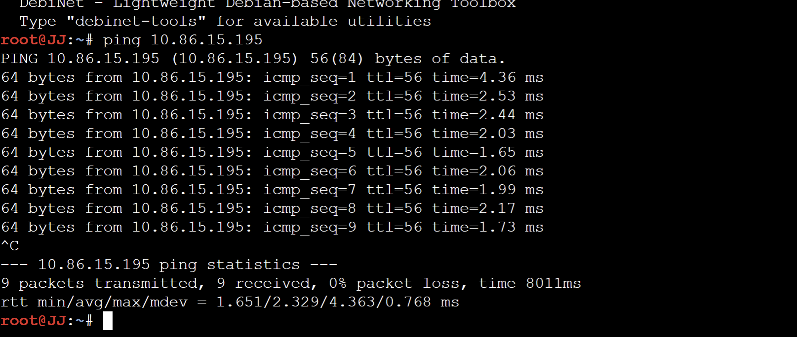

*Gambar 4. Ping JJ (10.86.14.2) ke Mika (10.86.15.195) dengan TTL 56*

<br>

**Pengujian 2, Mika ke Masayuki**

```sh
ping 10.86.8.2
```

<br>

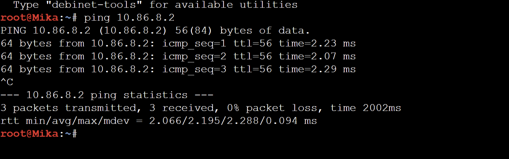

*Gambar 5. Ping Mika (10.86.15.195) ke Masayuki (10.86.8.2) dengan TTL 56*

<br>

**Pengujian 3, Semi ke Omnipresence**

```sh
ping 10.86.4.2
```

<br>

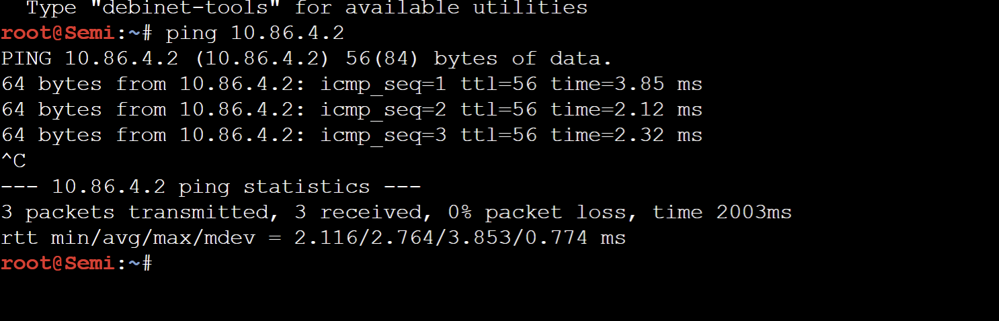

*Gambar 6. Ping Semi (10.86.16.2) ke Omnipresence (10.86.4.2) dengan TTL 56*

<br>

**Pengujian 4, Semi ke Taro**

```sh
ping 10.86.15.66
```

<br>

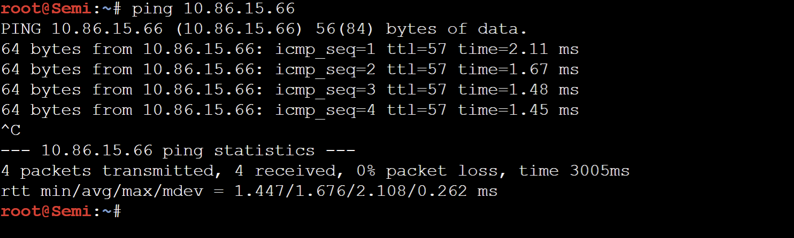

*Gambar 7. Ping Semi (10.86.16.2) ke Taro (10.86.15.66) dengan TTL 57*

<br>

**Pengujian 5, Alice ke Yasuo**

```sh
ping 10.86.13.2
```

<br>

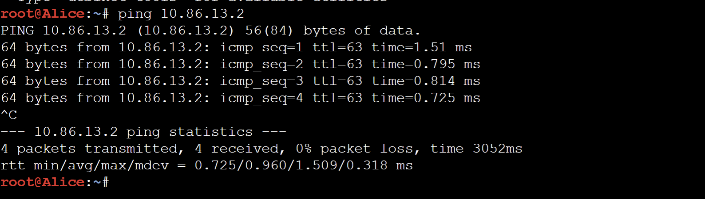

*Gambar 8. Ping Alice (10.86.12.2) ke Yasuo (10.86.13.2) dengan TTL 63*

<br>

**Hasil:**

- Kelima pengujian berhasil
- JJ ke Mika, Mika ke Masayuki, dan Semi ke Omnipresence melewati 8 router dengan TTL balasan 56. Ketiganya merupakan jalur terpanjang pada topologi, dari ujung cabang Cyberia, Shibuya, dan Phantoma menuju cabang lain.
- Semi ke Taro melewati 7 router dengan TTL 57, membuktikan jalur dari cabang Tachibana menuju cabang Navi.
- Alice (A11) ke Yasuo (A13) berada pada subnet berbeda di bawah router yang sama, sehingga hanya melewati Navi dengan TTL 63.
- Nilai TTL yang teramati sama dengan jumlah router pada jalur hasil rancangan routing, sehingga paket melewati jalur yang direncanakan.
- Kelima jalur tersebut melewati 12 dari 13 router (seluruh router kecuali Psyche) dan seluruh 9 link antar router.

---

## CIDR (Cisco Packet Tracer)

Pada Cisco Packet Tracer, topologi The Wired Expansion dikerjakan dengan metode CIDR. Subnet-subnet yang telah dihitung digabung secara bertahap dari ujung topologi menuju Wired mengikuti susunan router, sehingga setiap cabang menjadi satu blok CIDR yang bisa diwakili oleh satu rute. Perhitungan CIDR dikerjakan oleh Abhista Athallah Dyfan(006), sedangkan VLSM pada GNS3 dikerjakan oleh Rifqi Dwi Muslim(077).

### Daftar Node dan Topologi

| Jumlah | Jenis node | Node |
| ------ | ---------- | ---- |
| 13 | Router Cisco 2811 | Cyberia, Wired, Psyche, Copland, Schumann, Accela, Navi, Tachibana, Deus, Protocol7, Knights, Phantoma, Shibuya |
| 25 | PC-PT, Laptop-PT, Server-PT | JJ, MyuMyu, Karl, Lin, Juri, Masayuki, Akashic, Omnipresence, Denpa, Alice, Reika, Taro, Yasuo, Miho, Kuma, Collective, Ghost, Lilith, Specter, Chisa, Hodgeson, Eiri, Semi, Lain, Mika |
| 13 | Switch-PT | Switch0 sampai Switch12 |
| 1 | Cloud-PT | Cloud0 |

Router yang memiliki lebih dari 2 link (Cyberia, Wired, Copland, Schumann, Navi, Tachibana, Deus, Protocol7, Knights, Phantoma) dipasangi modul **NM-2FE2W** agar tersedia interface `FastEthernet1/0` dan `FastEthernet1/1`. Setiap end device mewakili seluruh host pada node tersebut, sehingga cukup diberi satu alamat IP. Aplikasi yang dipakai adalah Cisco Packet Tracer 9.0.1.

**TOPOLOGI JARINGAN:**
<br>

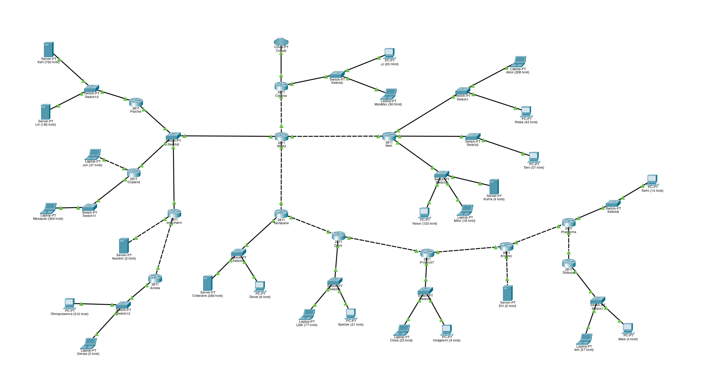

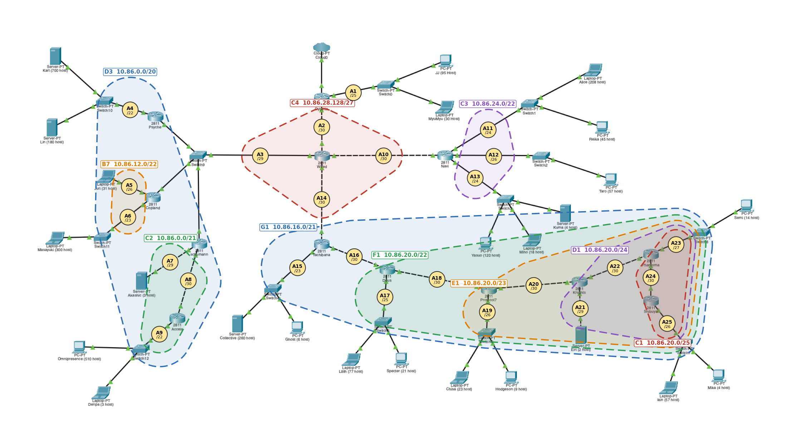

*Gambar 9. Topologi The Wired Expansion pada Cisco Packet Tracer*

<br>

---

### Rancangan Pengalamatan IP

Prefix kelompok tetap **`10.86.x.x`**. Hasil perhitungan CIDR menghasilkan root **`10.86.0.0/19`** (`255.255.224.0`) yang dibagi menjadi 25 subnet. Jumlah IP dan netmask setiap subnet sama dengan VLSM, sedangkan Network ID berbeda karena subnet ditempatkan berdasarkan penggabungan blok. Alamat terakhir yang terpakai adalah `10.86.28.151`.

| Subnet | Rute | Jumlah IP | Network ID | Netmask | Broadcast | Range IP |
| ------ | ---- | --------- | ---------- | ------- | --------- | -------- |
| A1 | Cyberia > JJ, MyuMyu | 126 | 10.86.28.0/25 | 255.255.255.128 | 10.86.28.127 | 10.86.28.1 - 10.86.28.126 |
| A2 | Cyberia > Wired | 2 | 10.86.28.144/30 | 255.255.255.252 | 10.86.28.147 | 10.86.28.145 - 10.86.28.146 |
| A3 | Wired > Switch2 > Psyche, Copland, Schumann | 4 | 10.86.28.128/29 | 255.255.255.248 | 10.86.28.135 | 10.86.28.129 - 10.86.28.134 |
| A4 | Psyche > Switch3 > Karl, Lin | 881 | 10.86.8.0/22 | 255.255.252.0 | 10.86.11.255 | 10.86.8.1 - 10.86.11.254 |
| A5 | Copland > Juri | 32 | 10.86.14.0/26 | 255.255.255.192 | 10.86.14.63 | 10.86.14.1 - 10.86.14.62 |
| A6 | Copland > Switch4 > Masayuki | 301 | 10.86.12.0/23 | 255.255.254.0 | 10.86.13.255 | 10.86.12.1 - 10.86.13.254 |
| A7 | Schumann > Akashic | 4 | 10.86.4.0/29 | 255.255.255.248 | 10.86.4.7 | 10.86.4.1 - 10.86.4.6 |
| A8 | Schumann > Accela | 2 | 10.86.4.8/30 | 255.255.255.252 | 10.86.4.11 | 10.86.4.9 - 10.86.4.10 |
| A9 | Accela > Switch5 > Omnipresence, Denpa | 514 | 10.86.0.0/22 | 255.255.252.0 | 10.86.3.255 | 10.86.0.1 - 10.86.3.254 |
| A10 | Wired > Navi | 2 | 10.86.28.148/30 | 255.255.255.252 | 10.86.28.151 | 10.86.28.149 - 10.86.28.150 |
| A11 | Navi > Switch6 > Alice, Reika | 254 | 10.86.24.0/24 | 255.255.255.0 | 10.86.24.255 | 10.86.24.1 - 10.86.24.254 |
| A12 | Navi > Switch7 > Taro | 58 | 10.86.26.0/26 | 255.255.255.192 | 10.86.26.63 | 10.86.26.1 - 10.86.26.62 |
| A13 | Navi > Switch8 > Yasuo, Miho, Kuma | 143 | 10.86.25.0/24 | 255.255.255.0 | 10.86.25.255 | 10.86.25.1 - 10.86.25.254 |
| A14 | Wired > Tachibana | 2 | 10.86.28.136/30 | 255.255.255.252 | 10.86.28.139 | 10.86.28.137 - 10.86.28.138 |
| A15 | Tachibana > Switch9 > Collective, Ghost | 267 | 10.86.16.0/23 | 255.255.254.0 | 10.86.17.255 | 10.86.16.1 - 10.86.17.254 |
| A16 | Tachibana > Deus | 2 | 10.86.18.0/30 | 255.255.255.252 | 10.86.18.3 | 10.86.18.1 - 10.86.18.2 |
| A17 | Deus > Switch10 > Lilith, Specter | 99 | 10.86.22.0/25 | 255.255.255.128 | 10.86.22.127 | 10.86.22.1 - 10.86.22.126 |
| A18 | Deus > Protocol7 | 2 | 10.86.22.128/30 | 255.255.255.252 | 10.86.22.131 | 10.86.22.129 - 10.86.22.130 |
| A19 | Protocol7 > Switch11 > Chisa, Hodgeson | 33 | 10.86.21.0/26 | 255.255.255.192 | 10.86.21.63 | 10.86.21.1 - 10.86.21.62 |
| A20 | Protocol7 > Knights | 2 | 10.86.21.64/30 | 255.255.255.252 | 10.86.21.67 | 10.86.21.65 - 10.86.21.66 |
| A21 | Knights > Eiri | 3 | 10.86.20.128/29 | 255.255.255.248 | 10.86.20.135 | 10.86.20.129 - 10.86.20.134 |
| A22 | Knights > Phantoma | 2 | 10.86.20.136/30 | 255.255.255.252 | 10.86.20.139 | 10.86.20.137 - 10.86.20.138 |
| A23 | Phantoma > Switch12 > Semi | 15 | 10.86.20.0/27 | 255.255.255.224 | 10.86.20.31 | 10.86.20.1 - 10.86.20.30 |
| A24 | Phantoma > Shibuya | 2 | 10.86.20.32/30 | 255.255.255.252 | 10.86.20.35 | 10.86.20.33 - 10.86.20.34 |
| A25 | Shibuya > Switch13 > Lain, Mika | 62 | 10.86.20.64/26 | 255.255.255.192 | 10.86.20.127 | 10.86.20.65 - 10.86.20.126 |

Link Cyberia ke Cloud0 berada di luar prefix kelompok, sehingga tidak dihitung sebagai subnet.

---

### Urutan Pengerjaan

1. Subnet diidentifikasi dari topologi, lalu Jumlah IP dan netmask setiap subnet dihitung (sama dengan Bagian 1 dan 2 pada VLSM).
2. Subnet digabung secara bertahap sampai menjadi satu blok root `/19`.
3. Root dibagi kembali dari atas ke bawah untuk menetapkan Network ID setiap subnet.
4. Alamat IP dibagikan ke setiap interface router dan end device.
5. Topologi dibangun di Cisco Packet Tracer, termasuk pemasangan modul dan pemilihan jenis kabel.
6. Setiap router dikonfigurasi melalui CLI, lalu end device melalui **Desktop > IP Configuration**.
7. Rute statis disusun dengan summarization sesuai blok hasil penggabungan.
8. Konektivitas diuji dengan `ping` dan `tracert` dari end device pada jalur terjauh.

---

### BAGIAN 1, IDENTIFIKASI SUBNET DAN KEBUTUHAN IP

Identifikasi subnet, Jumlah IP, netmask setiap subnet, dan netmask root (`/19`) sama dengan **Bagian 1 dan Bagian 2** pada VLSM karena keduanya bergantung pada topologi yang sama. Total ukuran blok adalah 4188 alamat sehingga netmask root yang dipakai adalah `/19`.

**Hasil:**

- 25 subnet dengan total ukuran blok 4188 alamat, melebihi 4096 sehingga `/20` tidak cukup.
- Netmask root adalah **`/19`** dengan rentang `10.86.0.0` sampai `10.86.31.255`.

---

### BAGIAN 2, PENGGABUNGAN SUBNET

Soal meminta pembagian IP dengan metode CIDR, sehingga subnet digabung dari bawah ke atas sampai menjadi satu blok.

Aturan penggabungan: dua subnet digabung menjadi satu blok yang cukup menampung keduanya. Ukuran blok gabungan adalah dua kali blok terbesar dari kedua subnet, sehingga:

```
netmask gabungan = netmask terkecil dari kedua subnet - 1
```

Contoh: `/30` digabung `/23` menjadi `/22`, dan `/26` digabung `/26` menjadi `/25`. Pasangan dipilih berdasarkan subnet yang bertetangga pada topologi, mulai dari ujung cabang menuju Wired, sehingga setiap cabang router menjadi satu blok.

| Level | Subnet | Gabungan dari | Netmask Akhir |
| ----- | ------ | ------------- | ------------- |
| I | B1 | A24 (/30) + A23 (/27) | /26 |
| I | B2 | A22 (/30) + A21 (/29) | /28 |
| I | B3 | A20 (/30) + A19 (/26) | /25 |
| I | B4 | A18 (/30) + A17 (/25) | /24 |
| I | B5 | A16 (/30) + A15 (/23) | /22 |
| I | B6 | A7 (/29) + A8 (/30) | /28 |
| I | B7 | A5 (/26) + A6 (/23) | /22 |
| I | B8 | A11 (/24) + A13 (/24) | /23 |
| I | B9 | A3 (/29) + A14 (/30) | /28 |
| I | B10 | A2 (/30) + A10 (/30) | /29 |
| II | C1 | B1 (/26) + A25 (/26) | /25 |
| II | C2 | B6 (/28) + A9 (/22) | /21 |
| II | C3 | B8 (/23) + A12 (/26) | /22 |
| II | C4 | B9 (/28) + B10 (/29) | /27 |
| II | C5 | A4 (/22) + B7 (/22) | /21 |
| III | D1 | B2 (/28) + C1 (/25) | /24 |
| III | D2 | C4 (/27) + A1 (/25) | /24 |
| III | D3 | C2 (/21) + C5 (/21) | /20 |
| IV | E1 | B3 (/25) + D1 (/24) | /23 |
| IV | E2 | C3 (/22) + D2 (/24) | /21 |
| V | F1 | B4 (/24) + E1 (/23) | /22 |
| VI | G1 | B5 (/22) + F1 (/22) | /21 |
| VII | H1 | G1 (/21) + E2 (/21) | /20 |
| VIII | I1 | D3 (/20) + H1 (/20) | /19 |

<br>

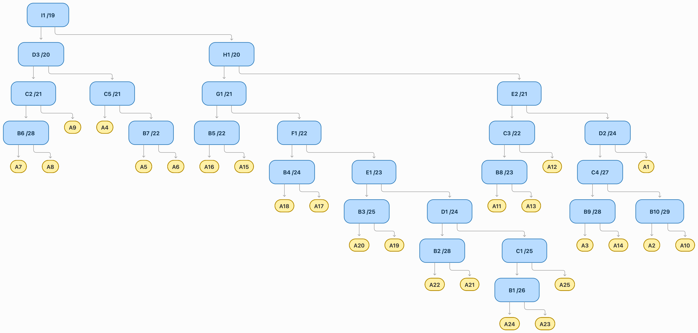

*Gambar 10. Pohon penggabungan CIDR K-45 dengan root 10.86.0.0/19*

<br>

Cara membaca pohon:

1. Elips kuning adalah subnet A1 sampai A25, sedangkan kotak biru adalah blok hasil penggabungan.
2. Cabang Tachibana sampai Shibuya menjadi satu rantai blok (`/21` > `/22` > `/23` > `/24` > `/25`) karena setiap router hanya memiliki satu router di bawahnya.
3. Cabang Psyche, Copland, dan Schumann menjadi blok `/20`, cabang Navi menjadi `/22`, dan A1 digabung dengan empat subnet di sekitar Wired (A2, A3, A10, A14) menjadi `/24`.

**Hasil:**

- 25 subnet tergabung menjadi satu blok `I1` dengan netmask **`/19`**, sama dengan hasil perhitungan root pada Bagian 1.
- Pada penggabungan berukuran berbeda, blok gabungan menyisakan ruang yang tidak terpakai, dan itu menjadi harga dari rute yang lebih ringkas.
- Hasil penggabungan diisikan ke sheet `Penggabungan - CIDR` pada template spreadsheet.

---

### BAGIAN 3, PEMBAGIAN IP DARI ROOT

Setelah penggabungan, Network ID setiap subnet ditetapkan dari atas ke bawah. Root `10.86.0.0/19` dibelah menjadi dua blok, lalu setiap blok dibelah lagi sesuai pasangan penggabungannya. Pada setiap pembelahan, blok yang lebih besar menempati alamat yang lebih rendah sehingga setiap blok jatuh pada batas yang valid.

| Blok | Gabungan dari | Network ID | Isi |
| ---- | ------------- | ---------- | --- |
| I1 | D3 + H1 | 10.86.0.0/19 | seluruh subnet |
| H1 | G1 + E2 | 10.86.16.0/20 | A1, A2, A3, A10, A11, A12, A13, A14, A15, A16, A17, A18, A19, A20, A21, A22, A23, A24, A25 |
| G1 | B5 + F1 | 10.86.16.0/21 | A15, A16, A17, A18, A19, A20, A21, A22, A23, A24, A25 |
| F1 | B4 + E1 | 10.86.20.0/22 | A17, A18, A19, A20, A21, A22, A23, A24, A25 |
| E1 | B3 + D1 | 10.86.20.0/23 | A19, A20, A21, A22, A23, A24, A25 |
| E2 | C3 + D2 | 10.86.24.0/21 | A1, A2, A3, A10, A11, A12, A13, A14 |
| D1 | B2 + C1 | 10.86.20.0/24 | A21, A22, A23, A24, A25 |
| D2 | C4 + A1 | 10.86.28.0/24 | A1, A2, A3, A10, A14 |
| D3 | C2 + C5 | 10.86.0.0/20 | A4, A5, A6, A7, A8, A9 |
| C1 | B1 + A25 | 10.86.20.0/25 | A23, A24, A25 |
| C2 | B6 + A9 | 10.86.0.0/21 | A7, A8, A9 |
| C3 | B8 + A12 | 10.86.24.0/22 | A11, A12, A13 |
| C4 | B9 + B10 | 10.86.28.128/27 | A2, A3, A10, A14 |
| C5 | A4 + B7 | 10.86.8.0/21 | A4, A5, A6 |
| B1 | A24 + A23 | 10.86.20.0/26 | A23, A24 |
| B2 | A22 + A21 | 10.86.20.128/28 | A21, A22 |
| B3 | A20 + A19 | 10.86.21.0/25 | A19, A20 |
| B4 | A18 + A17 | 10.86.22.0/24 | A17, A18 |
| B5 | A16 + A15 | 10.86.16.0/22 | A15, A16 |
| B6 | A7 + A8 | 10.86.4.0/28 | A7, A8 |
| B7 | A5 + A6 | 10.86.12.0/22 | A5, A6 |
| B8 | A11 + A13 | 10.86.24.0/23 | A11, A13 |
| B9 | A3 + A14 | 10.86.28.128/28 | A3, A14 |
| B10 | A2 + A10 | 10.86.28.144/29 | A2, A10 |

**Hasil:**

- Seluruh 25 subnet mendapat Network ID tanpa tumpang tindih dan berada di dalam blok gabungannya.
- Rentang yang terpakai adalah `10.86.0.0` sampai `10.86.28.151`, dengan sisa alamat `10.86.28.152` sampai `10.86.31.255` yang tidak terpakai.
- Hasil pembagian diisikan ke sheet `Pembagian IP - CIDR` pada template spreadsheet.

---

### BAGIAN 4, PENGALAMATAN INTERFACE ROUTER DAN END DEVICE

Aturan pengalamatan sama dengan VLSM: router yang lebih dekat ke Cyberia mendapat IP usable pertama pada link antar-router, urutan segmen bersama A3 adalah Wired, Psyche, Copland, lalu Schumann, dan interface router pada subnet LAN mendapat IP usable pertama sebagai gateway.

**Interface router:**

| Router | Interface | Terhubung ke | Subnet | IP Address | Netmask |
| ------ | --------- | ------------ | ------ | ---------- | ------- |
| Cyberia | FastEthernet0/1 | Cloud0 | - | - | - |
| Cyberia | FastEthernet0/0 | Wired | A2 | 10.86.28.145 | 255.255.255.252 |
| Cyberia | FastEthernet1/0 | Switch0 (JJ, MyuMyu) | A1 | 10.86.28.1 | 255.255.255.128 |
| Wired | FastEthernet0/0 | Cyberia | A2 | 10.86.28.146 | 255.255.255.252 |
| Wired | FastEthernet0/1 | Navi | A10 | 10.86.28.149 | 255.255.255.252 |
| Wired | FastEthernet1/0 | Tachibana | A14 | 10.86.28.137 | 255.255.255.252 |
| Wired | FastEthernet1/1 | Switch9 | A3 | 10.86.28.129 | 255.255.255.248 |
| Psyche | FastEthernet0/0 | Switch9 | A3 | 10.86.28.130 | 255.255.255.248 |
| Psyche | FastEthernet0/1 | Switch10 (Karl, Lin) | A4 | 10.86.8.1 | 255.255.252.0 |
| Copland | FastEthernet0/0 | Switch11 (Masayuki) | A6 | 10.86.12.1 | 255.255.254.0 |
| Copland | FastEthernet0/1 | Switch9 | A3 | 10.86.28.131 | 255.255.255.248 |
| Copland | FastEthernet1/0 | Juri | A5 | 10.86.14.1 | 255.255.255.192 |
| Schumann | FastEthernet0/0 | Switch9 | A3 | 10.86.28.132 | 255.255.255.248 |
| Schumann | FastEthernet0/1 | Akashic | A7 | 10.86.4.1 | 255.255.255.248 |
| Schumann | FastEthernet1/0 | Accela | A8 | 10.86.4.9 | 255.255.255.252 |
| Accela | FastEthernet0/0 | Schumann | A8 | 10.86.4.10 | 255.255.255.252 |
| Accela | FastEthernet0/1 | Switch12 (Omnipresence, Denpa) | A9 | 10.86.0.1 | 255.255.252.0 |
| Navi | FastEthernet0/0 | Wired | A10 | 10.86.28.150 | 255.255.255.252 |
| Navi | FastEthernet0/1 | Switch1 (Alice, Reika) | A11 | 10.86.24.1 | 255.255.255.0 |
| Navi | FastEthernet1/0 | Switch2 (Taro) | A12 | 10.86.26.1 | 255.255.255.192 |
| Navi | FastEthernet1/1 | Switch3 (Kuma, Miho, Yasuo) | A13 | 10.86.25.1 | 255.255.255.0 |
| Tachibana | FastEthernet0/0 | Wired | A14 | 10.86.28.138 | 255.255.255.252 |
| Tachibana | FastEthernet0/1 | Deus | A16 | 10.86.18.1 | 255.255.255.252 |
| Tachibana | FastEthernet1/0 | Switch4 (Collective, Ghost) | A15 | 10.86.16.1 | 255.255.254.0 |
| Deus | FastEthernet0/0 | Tachibana | A16 | 10.86.18.2 | 255.255.255.252 |
| Deus | FastEthernet0/1 | Protocol7 | A18 | 10.86.22.129 | 255.255.255.252 |
| Deus | FastEthernet1/0 | Switch5 (Lilith, Specter) | A17 | 10.86.22.1 | 255.255.255.128 |
| Protocol7 | FastEthernet0/0 | Deus | A18 | 10.86.22.130 | 255.255.255.252 |
| Protocol7 | FastEthernet0/1 | Knights | A20 | 10.86.21.65 | 255.255.255.252 |
| Protocol7 | FastEthernet1/0 | Switch6 (Chisa, Hodgeson) | A19 | 10.86.21.1 | 255.255.255.192 |
| Knights | FastEthernet0/0 | Protocol7 | A20 | 10.86.21.66 | 255.255.255.252 |
| Knights | FastEthernet0/1 | Phantoma | A22 | 10.86.20.137 | 255.255.255.252 |
| Knights | FastEthernet1/0 | Eiri | A21 | 10.86.20.129 | 255.255.255.248 |
| Phantoma | FastEthernet0/0 | Knights | A22 | 10.86.20.138 | 255.255.255.252 |
| Phantoma | FastEthernet0/1 | Switch8 (Semi) | A23 | 10.86.20.1 | 255.255.255.224 |
| Phantoma | FastEthernet1/0 | Shibuya | A24 | 10.86.20.33 | 255.255.255.252 |
| Shibuya | FastEthernet0/0 | Phantoma | A24 | 10.86.20.34 | 255.255.255.252 |
| Shibuya | FastEthernet0/1 | Switch7 (Lain, Mika) | A25 | 10.86.20.65 | 255.255.255.192 |

**End device:**

| End Device | Jumlah Host | Subnet | IP Address | Netmask | Gateway |
| ---------- | ----------- | ------ | ---------- | ------- | ------- |
| JJ | 95 | A1 | 10.86.28.2 | 255.255.255.128 | 10.86.28.1 |
| MyuMyu | 30 | A1 | 10.86.28.3 | 255.255.255.128 | 10.86.28.1 |
| Karl | 700 | A4 | 10.86.8.2 | 255.255.252.0 | 10.86.8.1 |
| Lin | 180 | A4 | 10.86.8.3 | 255.255.252.0 | 10.86.8.1 |
| Juri | 31 | A5 | 10.86.14.2 | 255.255.255.192 | 10.86.14.1 |
| Masayuki | 300 | A6 | 10.86.12.2 | 255.255.254.0 | 10.86.12.1 |
| Akashic | 3 | A7 | 10.86.4.2 | 255.255.255.248 | 10.86.4.1 |
| Omnipresence | 510 | A9 | 10.86.0.2 | 255.255.252.0 | 10.86.0.1 |
| Denpa | 3 | A9 | 10.86.0.3 | 255.255.252.0 | 10.86.0.1 |
| Alice | 208 | A11 | 10.86.24.2 | 255.255.255.0 | 10.86.24.1 |
| Reika | 45 | A11 | 10.86.24.3 | 255.255.255.0 | 10.86.24.1 |
| Taro | 57 | A12 | 10.86.26.2 | 255.255.255.192 | 10.86.26.1 |
| Yasuo | 120 | A13 | 10.86.25.2 | 255.255.255.0 | 10.86.25.1 |
| Miho | 18 | A13 | 10.86.25.3 | 255.255.255.0 | 10.86.25.1 |
| Kuma | 4 | A13 | 10.86.25.4 | 255.255.255.0 | 10.86.25.1 |
| Collective | 260 | A15 | 10.86.16.2 | 255.255.254.0 | 10.86.16.1 |
| Ghost | 6 | A15 | 10.86.16.3 | 255.255.254.0 | 10.86.16.1 |
| Lilith | 77 | A17 | 10.86.22.2 | 255.255.255.128 | 10.86.22.1 |
| Specter | 21 | A17 | 10.86.22.3 | 255.255.255.128 | 10.86.22.1 |
| Chisa | 23 | A19 | 10.86.21.2 | 255.255.255.192 | 10.86.21.1 |
| Hodgeson | 9 | A19 | 10.86.21.3 | 255.255.255.192 | 10.86.21.1 |
| Eiri | 2 | A21 | 10.86.20.130 | 255.255.255.248 | 10.86.20.129 |
| Semi | 14 | A23 | 10.86.20.2 | 255.255.255.224 | 10.86.20.1 |
| Lain | 57 | A25 | 10.86.20.66 | 255.255.255.192 | 10.86.20.65 |
| Mika | 4 | A25 | 10.86.20.67 | 255.255.255.192 | 10.86.20.65 |

---

### BAGIAN 5, PEMBUATAN TOPOLOGI PADA CISCO PACKET TRACER

Soal meminta membangun topologi sesuai gambar soal. Seluruh router memakai Cisco 2811, switch memakai Switch-PT, dan Cloud0 dipakai sebagai penghubung Cyberia ke dunia luar.

Pemilihan kabel:

- **Copper Cross-Over** untuk perangkat sejenis, yaitu link antar-router serta Juri, Akashic, dan Eiri yang terhubung langsung ke router.
- **Copper Straight-Through** untuk router ke switch, switch ke end device, dan Cloud0 ke Cyberia.

| No | Node A | Interface A | Node B | Interface B | Subnet | Kabel |
| -- | ------ | ----------- | ------ | ----------- | ------ | ----- |
| 1 | Cloud0 | Ethernet6 | Cyberia | Fa0/1 | - | Straight-through |
| 2 | Cyberia | Fa1/0 | Switch0 | Fa0/1 | A1 | Straight-through |
| 3 | JJ | Fa0 | Switch0 | Fa1/1 | A1 | Straight-through |
| 4 | MyuMyu | Fa0 | Switch0 | Fa2/1 | A1 | Straight-through |
| 5 | Cyberia | Fa0/0 | Wired | Fa0/0 | A2 | Crossover |
| 6 | Copland | Fa0/1 | Switch9 | Fa2/1 | A3 | Straight-through |
| 7 | Switch9 | Fa1/1 | Schumann | Fa0/0 | A3 | Straight-through |
| 8 | Switch9 | Fa3/1 | Psyche | Fa0/0 | A3 | Straight-through |
| 9 | Wired | Fa1/1 | Switch9 | Fa0/1 | A3 | Straight-through |
| 10 | Karl | Fa0 | Switch10 | Fa1/1 | A4 | Straight-through |
| 11 | Psyche | Fa0/1 | Switch10 | Fa0/1 | A4 | Straight-through |
| 12 | Switch10 | Fa2/1 | Lin | Fa0 | A4 | Straight-through |
| 13 | Copland | Fa1/0 | Juri | Fa0 | A5 | Crossover |
| 14 | Masayuki | Fa0 | Switch11 | Fa0/1 | A6 | Straight-through |
| 15 | Switch11 | Fa1/1 | Copland | Fa0/0 | A6 | Straight-through |
| 16 | Akashic | Fa0 | Schumann | Fa0/1 | A7 | Crossover |
| 17 | Schumann | Fa1/0 | Accela | Fa0/0 | A8 | Crossover |
| 18 | Omnipresence | Fa0 | Switch12 | Fa0/1 | A9 | Straight-through |
| 19 | Switch12 | Fa1/1 | Denpa | Fa0 | A9 | Straight-through |
| 20 | Switch12 | Fa2/1 | Accela | Fa0/1 | A9 | Straight-through |
| 21 | Wired | Fa0/1 | Navi | Fa0/0 | A10 | Crossover |
| 22 | Alice | Fa0 | Switch1 | Fa1/1 | A11 | Straight-through |
| 23 | Navi | Fa0/1 | Switch1 | Fa0/1 | A11 | Straight-through |
| 24 | Switch1 | Fa2/1 | Reika | Fa0 | A11 | Straight-through |
| 25 | Navi | Fa1/0 | Switch2 | Fa0/1 | A12 | Straight-through |
| 26 | Switch2 | Fa1/1 | Taro | Fa0 | A12 | Straight-through |
| 27 | Navi | Fa1/1 | Switch3 | Fa0/1 | A13 | Straight-through |
| 28 | Switch3 | Fa1/1 | Kuma | Fa0 | A13 | Straight-through |
| 29 | Switch3 | Fa2/1 | Miho | Fa0 | A13 | Straight-through |
| 30 | Switch3 | Fa3/1 | Yasuo | Fa0 | A13 | Straight-through |
| 31 | Wired | Fa1/0 | Tachibana | Fa0/0 | A14 | Crossover |
| 32 | Switch4 | Fa1/1 | Collective | Fa0 | A15 | Straight-through |
| 33 | Switch4 | Fa2/1 | Ghost | Fa0 | A15 | Straight-through |
| 34 | Tachibana | Fa1/0 | Switch4 | Fa0/1 | A15 | Straight-through |
| 35 | Tachibana | Fa0/1 | Deus | Fa0/0 | A16 | Crossover |
| 36 | Deus | Fa1/0 | Switch5 | Fa0/1 | A17 | Straight-through |
| 37 | Switch5 | Fa1/1 | Lilith | Fa0 | A17 | Straight-through |
| 38 | Switch5 | Fa2/1 | Specter | Fa0 | A17 | Straight-through |
| 39 | Deus | Fa0/1 | Protocol7 | Fa0/0 | A18 | Crossover |
| 40 | Protocol7 | Fa1/0 | Switch6 | Fa0/1 | A19 | Straight-through |
| 41 | Switch6 | Fa1/1 | Chisa | Fa0 | A19 | Straight-through |
| 42 | Switch6 | Fa2/1 | Hodgeson | Fa0 | A19 | Straight-through |
| 43 | Protocol7 | Fa0/1 | Knights | Fa0/0 | A20 | Crossover |
| 44 | Knights | Fa1/0 | Eiri | Fa0 | A21 | Crossover |
| 45 | Knights | Fa0/1 | Phantoma | Fa0/0 | A22 | Crossover |
| 46 | Phantoma | Fa0/1 | Switch8 | Fa0/1 | A23 | Straight-through |
| 47 | Semi | Fa0 | Switch8 | Fa1/1 | A23 | Straight-through |
| 48 | Phantoma | Fa1/0 | Shibuya | Fa0/0 | A24 | Crossover |
| 49 | Shibuya | Fa0/1 | Switch7 | Fa0/1 | A25 | Straight-through |
| 50 | Switch7 | Fa1/1 | Lain | Fa0 | A25 | Straight-through |
| 51 | Switch7 | Fa2/1 | Mika | Fa0 | A25 | Straight-through |

**Hasil:**

- Topologi berisi 52 perangkat dan 51 link sesuai gambar soal.
- Terdapat 12 link crossover dan 39 link straight-through.
- Penamaan Switch0 sampai Switch12 mengikuti label pada file Packet Tracer.

---

### BAGIAN 6, KONFIGURASI ROUTER

Setiap router dikonfigurasi melalui tab **CLI**. Perintah `ip address` memberi alamat pada interface sesuai Bagian 4, `no shutdown` mengaktifkan interface, dan `ip route <Network ID> <Netmask> <next hop>` membuat rute statis. Baris `write memory` menyimpan konfigurasi ke startup-config.

**Cyberia**

```
enable
configure terminal
hostname Cyberia
no ip domain-lookup
interface FastEthernet0/0
 description A2 10.86.28.144/30
 ip address 10.86.28.145 255.255.255.252
 no shutdown
 exit
interface FastEthernet1/0
 description A1 10.86.28.0/25
 ip address 10.86.28.1 255.255.255.128
 no shutdown
 exit
ip route 10.86.0.0 255.255.224.0 10.86.28.146
end
write memory
```

**Wired**

```
enable
configure terminal
hostname Wired
no ip domain-lookup
interface FastEthernet0/0
 description A2 10.86.28.144/30
 ip address 10.86.28.146 255.255.255.252
 no shutdown
 exit
interface FastEthernet0/1
 description A10 10.86.28.148/30
 ip address 10.86.28.149 255.255.255.252
 no shutdown
 exit
interface FastEthernet1/0
 description A14 10.86.28.136/30
 ip address 10.86.28.137 255.255.255.252
 no shutdown
 exit
interface FastEthernet1/1
 description A3 10.86.28.128/29
 ip address 10.86.28.129 255.255.255.248
 no shutdown
 exit
ip route 0.0.0.0 0.0.0.0 10.86.28.145
ip route 10.86.28.0 255.255.255.128 10.86.28.145
ip route 10.86.8.0 255.255.252.0 10.86.28.130
ip route 10.86.12.0 255.255.252.0 10.86.28.131
ip route 10.86.0.0 255.255.248.0 10.86.28.132
ip route 10.86.24.0 255.255.252.0 10.86.28.150
ip route 10.86.16.0 255.255.248.0 10.86.28.138
end
write memory
```

**Psyche**

```
enable
configure terminal
hostname Psyche
no ip domain-lookup
interface FastEthernet0/0
 description A3 10.86.28.128/29
 ip address 10.86.28.130 255.255.255.248
 no shutdown
 exit
interface FastEthernet0/1
 description A4 10.86.8.0/22
 ip address 10.86.8.1 255.255.252.0
 no shutdown
 exit
ip route 0.0.0.0 0.0.0.0 10.86.28.129
end
write memory
```

**Copland**

```
enable
configure terminal
hostname Copland
no ip domain-lookup
interface FastEthernet0/0
 description A6 10.86.12.0/23
 ip address 10.86.12.1 255.255.254.0
 no shutdown
 exit
interface FastEthernet0/1
 description A3 10.86.28.128/29
 ip address 10.86.28.131 255.255.255.248
 no shutdown
 exit
interface FastEthernet1/0
 description A5 10.86.14.0/26
 ip address 10.86.14.1 255.255.255.192
 no shutdown
 exit
ip route 0.0.0.0 0.0.0.0 10.86.28.129
end
write memory
```

**Schumann**

```
enable
configure terminal
hostname Schumann
no ip domain-lookup
interface FastEthernet0/0
 description A3 10.86.28.128/29
 ip address 10.86.28.132 255.255.255.248
 no shutdown
 exit
interface FastEthernet0/1
 description A7 10.86.4.0/29
 ip address 10.86.4.1 255.255.255.248
 no shutdown
 exit
interface FastEthernet1/0
 description A8 10.86.4.8/30
 ip address 10.86.4.9 255.255.255.252
 no shutdown
 exit
ip route 0.0.0.0 0.0.0.0 10.86.28.129
ip route 10.86.0.0 255.255.252.0 10.86.4.10
end
write memory
```

**Accela**

```
enable
configure terminal
hostname Accela
no ip domain-lookup
interface FastEthernet0/0
 description A8 10.86.4.8/30
 ip address 10.86.4.10 255.255.255.252
 no shutdown
 exit
interface FastEthernet0/1
 description A9 10.86.0.0/22
 ip address 10.86.0.1 255.255.252.0
 no shutdown
 exit
ip route 0.0.0.0 0.0.0.0 10.86.4.9
end
write memory
```

**Navi**

```
enable
configure terminal
hostname Navi
no ip domain-lookup
interface FastEthernet0/0
 description A10 10.86.28.148/30
 ip address 10.86.28.150 255.255.255.252
 no shutdown
 exit
interface FastEthernet0/1
 description A11 10.86.24.0/24
 ip address 10.86.24.1 255.255.255.0
 no shutdown
 exit
interface FastEthernet1/0
 description A12 10.86.26.0/26
 ip address 10.86.26.1 255.255.255.192
 no shutdown
 exit
interface FastEthernet1/1
 description A13 10.86.25.0/24
 ip address 10.86.25.1 255.255.255.0
 no shutdown
 exit
ip route 0.0.0.0 0.0.0.0 10.86.28.149
end
write memory
```

**Tachibana**

```
enable
configure terminal
hostname Tachibana
no ip domain-lookup
interface FastEthernet0/0
 description A14 10.86.28.136/30
 ip address 10.86.28.138 255.255.255.252
 no shutdown
 exit
interface FastEthernet0/1
 description A16 10.86.18.0/30
 ip address 10.86.18.1 255.255.255.252
 no shutdown
 exit
interface FastEthernet1/0
 description A15 10.86.16.0/23
 ip address 10.86.16.1 255.255.254.0
 no shutdown
 exit
ip route 0.0.0.0 0.0.0.0 10.86.28.137
ip route 10.86.20.0 255.255.252.0 10.86.18.2
end
write memory
```

**Deus**

```
enable
configure terminal
hostname Deus
no ip domain-lookup
interface FastEthernet0/0
 description A16 10.86.18.0/30
 ip address 10.86.18.2 255.255.255.252
 no shutdown
 exit
interface FastEthernet0/1
 description A18 10.86.22.128/30
 ip address 10.86.22.129 255.255.255.252
 no shutdown
 exit
interface FastEthernet1/0
 description A17 10.86.22.0/25
 ip address 10.86.22.1 255.255.255.128
 no shutdown
 exit
ip route 0.0.0.0 0.0.0.0 10.86.18.1
ip route 10.86.20.0 255.255.254.0 10.86.22.130
end
write memory
```

**Protocol7**

```
enable
configure terminal
hostname Protocol7
no ip domain-lookup
interface FastEthernet0/0
 description A18 10.86.22.128/30
 ip address 10.86.22.130 255.255.255.252
 no shutdown
 exit
interface FastEthernet0/1
 description A20 10.86.21.64/30
 ip address 10.86.21.65 255.255.255.252
 no shutdown
 exit
interface FastEthernet1/0
 description A19 10.86.21.0/26
 ip address 10.86.21.1 255.255.255.192
 no shutdown
 exit
ip route 0.0.0.0 0.0.0.0 10.86.22.129
ip route 10.86.20.0 255.255.255.0 10.86.21.66
end
write memory
```

**Knights**

```
enable
configure terminal
hostname Knights
no ip domain-lookup
interface FastEthernet0/0
 description A20 10.86.21.64/30
 ip address 10.86.21.66 255.255.255.252
 no shutdown
 exit
interface FastEthernet0/1
 description A22 10.86.20.136/30
 ip address 10.86.20.137 255.255.255.252
 no shutdown
 exit
interface FastEthernet1/0
 description A21 10.86.20.128/29
 ip address 10.86.20.129 255.255.255.248
 no shutdown
 exit
ip route 0.0.0.0 0.0.0.0 10.86.21.65
ip route 10.86.20.0 255.255.255.128 10.86.20.138
end
write memory
```

**Phantoma**

```
enable
configure terminal
hostname Phantoma
no ip domain-lookup
interface FastEthernet0/0
 description A22 10.86.20.136/30
 ip address 10.86.20.138 255.255.255.252
 no shutdown
 exit
interface FastEthernet0/1
 description A23 10.86.20.0/27
 ip address 10.86.20.1 255.255.255.224
 no shutdown
 exit
interface FastEthernet1/0
 description A24 10.86.20.32/30
 ip address 10.86.20.33 255.255.255.252
 no shutdown
 exit
ip route 0.0.0.0 0.0.0.0 10.86.20.137
ip route 10.86.20.64 255.255.255.192 10.86.20.34
end
write memory
```

**Shibuya**

```
enable
configure terminal
hostname Shibuya
no ip domain-lookup
interface FastEthernet0/0
 description A24 10.86.20.32/30
 ip address 10.86.20.34 255.255.255.252
 no shutdown
 exit
interface FastEthernet0/1
 description A25 10.86.20.64/26
 ip address 10.86.20.65 255.255.255.192
 no shutdown
 exit
ip route 0.0.0.0 0.0.0.0 10.86.20.33
end
write memory
```

Pemeriksaan di setiap router:

```
show ip interface brief
show ip route
```

**Hasil:**

- Setiap interface router memegang alamat sesuai tabel Bagian 4 dengan status `up/up`.
- Link Cyberia ke Cloud0 berada di luar subnet kelompok, sehingga interface `FastEthernet0/1` Cyberia tidak diberi alamat dari prefix kelompok.

---

### BAGIAN 7, KONFIGURASI END DEVICE

Setiap end device diberi alamat statis melalui **Desktop > IP Configuration** dengan pilihan **Static**, lalu diisi IPv4 Address, Subnet Mask, dan Default Gateway. Untuk Server, pengaturan yang sama tersedia pada tab **Config > FastEthernet0**. Nilai setiap end device sesuai tabel end device pada Bagian 4. Contoh pada JJ:

| Kolom | Nilai |
| ----- | ----- |
| IPv4 Address | 10.86.28.2 |
| Subnet Mask | 255.255.255.128 |
| Default Gateway | 10.86.28.1 |

**Hasil:**

- Ke-25 end device memegang satu alamat IP pada subnet masing-masing dengan gateway ke router subnetnya.

---

### BAGIAN 8, STATIC ROUTING

Menyusun routing seefisien mungkin sehingga seluruh node dapat saling terhubung. Karena setiap cabang sudah menjadi satu blok hasil penggabungan, satu rute summary cukup untuk menjangkau seluruh subnet di belakang satu router.

1. **Cyberia** memakai satu rute `10.86.0.0/19` melalui Wired. Subnet A1 yang terhubung langsung tetap dipilih lewat rute connected karena lebih spesifik.
2. **Wired** memakai satu default route ke Cyberia dan enam rute spesifik: A1 ke Cyberia, `10.86.8.0/22` ke Psyche, `10.86.12.0/22` ke Copland, `10.86.0.0/21` ke Schumann, `10.86.24.0/22` ke Navi, dan `10.86.16.0/21` ke Tachibana.
3. **Schumann, Tachibana, Deus, Protocol7, Knights, dan Phantoma** memakai satu default route ke router di atasnya, ditambah satu rute summary ke blok router di bawahnya.
4. **Psyche, Copland, Accela, Navi, dan Shibuya** cukup memakai satu default route.

| Router | Default Route | Rute Spesifik | Total |
| ------ | ------------- | ------------- | ----- |
| Cyberia | - | 1 | 1 |
| Wired | via Cyberia | 6 | 7 |
| Psyche | via Wired | 0 | 1 |
| Copland | via Wired | 0 | 1 |
| Schumann | via Wired | 1 | 2 |
| Accela | via Schumann | 0 | 1 |
| Navi | via Wired | 0 | 1 |
| Tachibana | via Wired | 1 | 2 |
| Deus | via Tachibana | 1 | 2 |
| Protocol7 | via Deus | 1 | 2 |
| Knights | via Protocol7 | 1 | 2 |
| Phantoma | via Knights | 1 | 2 |
| Shibuya | via Phantoma | 0 | 1 |
| **Total** | | | **25** |

Perintah rute setiap router (sama dengan baris `ip route` pada Bagian 6):

**Cyberia**

```
ip route 10.86.0.0 255.255.224.0 10.86.28.146
```

**Wired**

```
ip route 0.0.0.0 0.0.0.0 10.86.28.145
ip route 10.86.28.0 255.255.255.128 10.86.28.145
ip route 10.86.8.0 255.255.252.0 10.86.28.130
ip route 10.86.12.0 255.255.252.0 10.86.28.131
ip route 10.86.0.0 255.255.248.0 10.86.28.132
ip route 10.86.24.0 255.255.252.0 10.86.28.150
ip route 10.86.16.0 255.255.248.0 10.86.28.138
```

**Psyche**

```
ip route 0.0.0.0 0.0.0.0 10.86.28.129
```

**Copland**

```
ip route 0.0.0.0 0.0.0.0 10.86.28.129
```

**Schumann**

```
ip route 0.0.0.0 0.0.0.0 10.86.28.129
ip route 10.86.0.0 255.255.252.0 10.86.4.10
```

**Accela**

```
ip route 0.0.0.0 0.0.0.0 10.86.4.9
```

**Navi**

```
ip route 0.0.0.0 0.0.0.0 10.86.28.149
```

**Tachibana**

```
ip route 0.0.0.0 0.0.0.0 10.86.28.137
ip route 10.86.20.0 255.255.252.0 10.86.18.2
```

**Deus**

```
ip route 0.0.0.0 0.0.0.0 10.86.18.1
ip route 10.86.20.0 255.255.254.0 10.86.22.130
```

**Protocol7**

```
ip route 0.0.0.0 0.0.0.0 10.86.22.129
ip route 10.86.20.0 255.255.255.0 10.86.21.66
```

**Knights**

```
ip route 0.0.0.0 0.0.0.0 10.86.21.65
ip route 10.86.20.0 255.255.255.128 10.86.20.138
```

**Phantoma**

```
ip route 0.0.0.0 0.0.0.0 10.86.20.137
ip route 10.86.20.64 255.255.255.192 10.86.20.34
```

**Shibuya**

```
ip route 0.0.0.0 0.0.0.0 10.86.20.33
```

**Hasil:**

- Total 25 rute statis untuk 25 subnet, jauh lebih sedikit dibanding VLSM karena setiap cabang diwakili satu rute summary.
- Wired hanya memiliki 7 rute meskipun menjangkau 25 subnet.
- `show ip route` pada setiap router menampilkan subnet terhubung langsung (`C`), rute statis (`S`), dan default route (`S*`) sesuai tabel.

---

### BAGIAN 9, PENGUJIAN KONEKSI

Membuktikan seluruh node terkoneksi dan dapat melakukan `ping` ke node lainnya.

Pengujian dilakukan dari **Desktop > Command Prompt** pada end device. Pengujian pertama diambil dari jalur terjauh yang melewati 8 router. TTL awal pada end device Packet Tracer adalah 128 dan setiap router mengurangi TTL sebesar 1, sehingga TTL = 128 - jumlah router.

| No | Asal | Tujuan | IP Tujuan | Jalur | Router | TTL |
| -- | ---- | ------ | --------- | ----- | ------ | --- |
| 1 | JJ (A1) | Mika (A25) | 10.86.20.67 | Cyberia > Wired > Tachibana > Deus > Protocol7 > Knights > Phantoma > Shibuya | 8 | 120 |

**Pengujian 1, JJ ke Mika**

```
ping 10.86.20.67
```

Hasil yang tercatat: 4 paket terkirim dan 4 paket diterima (0% loss) dengan `TTL=120`.

<br>

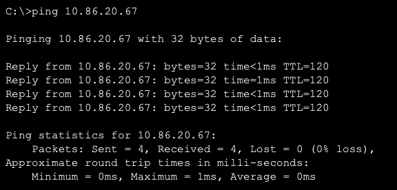

*Gambar 11. Ping JJ (10.86.28.2) ke Mika (10.86.20.67) dengan TTL 120*

<br>

**Pengujian 2, tracert JJ ke Mika**

```
tracert 10.86.20.67
```

| Hop | IP | Perangkat |
| --- | -- | --------- |
| 1 | 10.86.28.1 | Cyberia |
| 2 | 10.86.28.146 | Wired |
| 3 | 10.86.28.138 | Tachibana |
| 4 | 10.86.18.2 | Deus |
| 5 | 10.86.22.130 | Protocol7 |
| 6 | 10.86.21.66 | Knights |
| 7 | 10.86.20.138 | Phantoma |
| 8 | 10.86.20.34 | Shibuya |
| 9 | 10.86.20.67 | Mika |

<br>


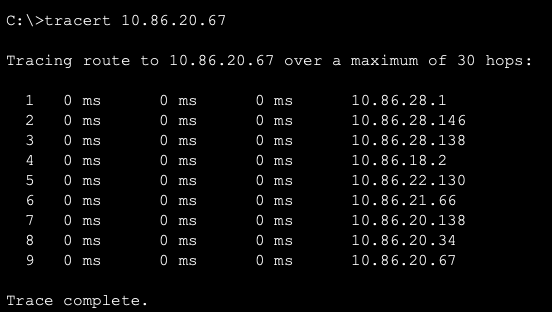


*Gambar 12. Tracert JJ ke Mika melewati 8 router*

<br>

**Hasil:**

- `ping` JJ ke Mika berhasil dengan TTL 120, sama dengan 128 dikurangi 8 router pada jalur terjauh.
- `tracert` menampilkan 8 router dan Mika di hop ke-9, sesuai urutan jalur rancangan routing.
- Jalur ini melewati Cyberia, Wired, Tachibana, Deus, Protocol7, Knights, Phantoma, dan Shibuya, sehingga rute summary pada router-router tersebut terbukti bekerja.

---

### PERBANDINGAN VLSM DAN CIDR

| Aspek | VLSM (GNS3) | CIDR (Cisco Packet Tracer) |
| ----- | ----------- | -------------------------- |
| Root | 10.86.0.0/19 | 10.86.0.0/19 |
| Cara menentukan Network ID | Blok diurutkan dari yang terbesar lalu ditempatkan berurutan | Subnet digabung menjadi blok bersarang lalu dibelah dari root |
| Network ID A1 | 10.86.14.0/25 | 10.86.28.0/25 |
| Network ID A4 | 10.86.0.0/22 | 10.86.8.0/22 |
| Alamat terakhir yang terpakai | 10.86.16.91 | 10.86.28.151 |
| Jumlah rute statis | banyak, satu rute per subnet di belakang router | 25, satu rute summary per cabang |